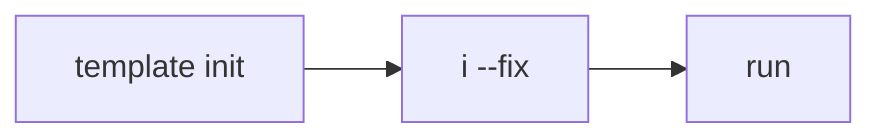
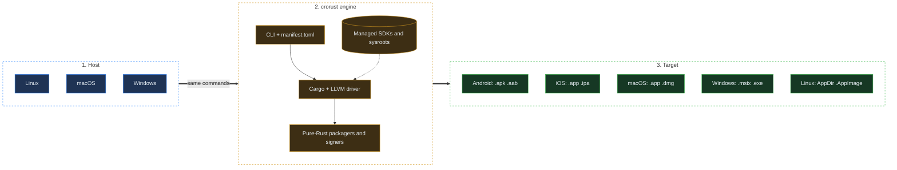
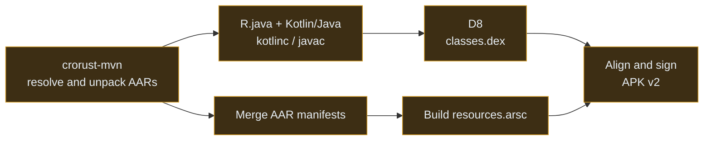

<div align="center">
  
  <h1>crorust</h1>
  <p><strong>Build, cross-compile, sign and ship Rust apps to Android, iOS, macOS, Windows and Linux, from any of them.</strong></p>
  <p>
    <a href="https://github.com/adi1ahmad/crorust/actions"></a>
    
    
  </p>
  <p>
    <a href="#installation">Install</a> ·
    <a href="#quickstart">Quickstart</a> ·
    <a href="#what-can-build-what">Compatibility</a> ·
    <a href="#command-line-reference">CLI</a> ·
    <a href="#configuration-reference-manifesttoml">Config</a> ·
    <a href="#architecture">Architecture</a> ·
    <a href="#hermetic-toolchain-management">Toolchains</a> ·
    <a href="#documentation">Docs</a>
  </p>
</div>

---

`crorust` is a self-contained build, cross-compilation and packaging engine for Rust projects. It rests on two ideas:

- **Multi-host development.** Linux, macOS and Windows engineers use the same codebase and the same commands, with no host-specific wrapper scripts and no IDE lock-in.
- **Cross-target deployment.** Any host can compile, package and sign production artifacts (`.apk`, `.app`, `.msix`, `.AppImage`) for every supported platform.

Website: [crorust.com](https://crorust.com) · Repository: [github.com/adi1ahmad/crorust](https://github.com/adi1ahmad/crorust) · Author: Adil Ahmad <adilahmad@tuta.io>

---

## Why crorust

Shipping a Rust app to five platforms usually means five toolchains, and three of them only run on one OS. `crorust` replaces them with one CLI.

| To ship to | You normally need | With crorust |
| :--- | :--- | :--- |
| **Android** | Android Studio, Gradle, `aapt2`, `apksigner` | `crorust build -p android` |
| **iOS** | a Mac, Xcode, `codesign` | `crorust build -p ios` (any OS) |
| **macOS** | a Mac, notarization tools, `create-dmg` | `crorust build -p macos --format dmg` |
| **Windows** | Visual Studio, Windows SDK, `MakeAppx`, `signtool` | `crorust build -p windows` |
| **Linux** | `linuxdeploy`, `mksquashfs`, an AppImage runtime | `crorust build -p linux` |

- **Same commands on every host.** Linux, macOS and Windows behave identically.
- **Hermetic toolchains.** Missing SDKs (NDK, JDK 17, Kotlin, D8, Windows SDK, Apple SDKs) are downloaded once, SHA-256 verified, and kept in your project's `.cache/crorust/`. Delete the project, reclaim the space. Opt into a shared cache with `cache_scope = "global"`.
- **Pure-Rust packaging and signing.** APK (v2), `.app`/DMG/IPA, MSIX and AppImage are built in Rust, so output is the same whichever machine built it. Debug certificates are built in.
- **No Gradle by default.** Android compiles with `kotlinc`/`javac`, D8 and a PubGrub Maven resolver. Gradle remains an opt-in fallback (`--gradle`).
- **Drives plain LLVM.** `clang`, `lld`, `llvm-ar` and Cargo run through synthesized `RUSTFLAGS`/`CFLAGS`, with no IDE wrappers.

---

## Installation

**Cargo, from source** (clone, enter, install):
```sh
git clone https://github.com/adi1ahmad/crorust
cd crorust
cargo i
```
`cargo i` is a repo alias (see [`.cargo/config.toml`](.cargo/config.toml)) for `cargo install --path crates/crorust --locked`, so it only works inside the checkout.

**Cargo, straight from Git** (no clone):
```sh
cargo install --git https://github.com/adi1ahmad/crorust crorust
```

**Nix and flakes**
```sh
nix profile add github:adi1ahmad/crorust      # or: nix profile add .
nix run github:adi1ahmad/crorust -- i         # run without installing
```

<details>
<summary>Use it in your project's <code>flake.nix</code></summary>

```nix
{
  inputs = {
    nixpkgs.url = "github:NixOS/nixpkgs/nixpkgs-unstable";
    crorust.url = "github:adi1ahmad/crorust";
  };

  outputs = { self, nixpkgs, crorust }:
    let
      system = "x86_64-linux"; # or "aarch64-linux", "aarch64-darwin", etc.
      pkgs = import nixpkgs { inherit system; };
    in
    {
      devShells.${system}.default = pkgs.mkShell {
        packages = [ crorust.packages.${system}.default ];
      };
    };
}
```

The overlay `crorust.overlays.default` provides `pkgs.crorust` (wrapped with runtime fallbacks) and `pkgs.crorust-unwrapped`.
</details>

---

## Quickstart



**1. Scaffold an app** from the embedded template (`templates/crorust.ruxt`: egui, wgpu, Android GameActivity JNI, manifests for every platform), then let `crorust` install whatever toolchains are missing:
```sh
crorust template init my_app
cd my_app
crorust i --fix
```

**2. Run it.** No flags needed:
```sh
crorust run
```
`run` compiles, packages, signs, installs, launches, and streams stdout/logcat to your terminal. It picks where to run in this order:

| Priority | Target | When |
| :---: | :--- | :--- |
| 1 | Connected Android device (USB or Wi-Fi ADB) | one is attached |
| 2 | Connected iPhone or booted iOS Simulator | no Android device, one of these is present |
| 3 | The host machine | nothing else is connected |

Plug in a phone and `crorust run` goes to the phone. Unplug it and the same command runs on your desktop. Platform and architecture follow the chosen device.

**3. Be explicit when you need to.**
```sh
crorust devices                          # see everything crorust can target
crorust run --device adb:16ee50bc        # a specific phone
crorust run -p android                   # first Android device, error if none
crorust run -p ios --simulator           # iOS Simulator (macOS host)
crorust run --device host                # force the host even with a phone attached
crorust run -1                           # first connected device, never the host
```
```text
host                                              Linux               linux x64           Arch Linux 5.16.10-arch1-1
adb:16ee50bc                                      FP4                 android arm64       Android 11 (API 30)
imd:55abbd4b70af4353bdea2595bbddcac4a2b7891a      David’s iPhone      ios arm64           iPhone OS 15.3.1
sim:D9A01B2E-3184-4C2E-8A55-9B04D12FE3A1          iPhone 15 Pro       ios arm64           iOS 17.4 (Simulator)
```

> [!NOTE]
> `crorust build` does not look for devices. Without `-p` it builds for the host. Use `crorust build -p android` to package for a platform.

---

## What can build what

Pick the host you work on (row) and the platform you ship to (column).

|  | Linux | Android | iOS device | iOS Simulator | macOS | Windows |
| :--- | :---: | :---: | :---: | :---: | :---: | :---: |
| **Linux host** | 🟢 | 🟢 | 🟢 | 🔨 | 🔨 | 🔨 |
| **macOS host** | 🔨 | 🟢 | 🟢 | 🟢 | 🟢 | 🔨 |
| **Windows host** | 🔨 | 🟢 | 🟢 | 🔨 | 🔨 | 🟢 |

🟢 **Full**: build, package, sign, deploy, run and debug with LLDB. 🔨 **Build and sign only**: you get a valid, signed artifact; running it needs a machine of that OS.

Why the 🔨 cells are what they are:
- **iOS Simulator** needs the macOS Darwin kernel. Simulators run Mach-O binaries natively, they are not emulators.
- **macOS, Windows, Linux desktop** targets can only run on a matching host. Remote machines, VMs, WSL or Docker work, but `crorust` does not drive them.

### How each target is built

| Target | Architectures | Toolchain | Packaging and signing | Deploy and debug |
| :--- | :--- | :--- | :--- | :--- |
| **Linux** | `x86_64`, `aarch64` (glibc or static musl) | `clang` + `lld`, Linux sysroot | AppDir plus Type 2 AppImage via `backhand` (or host `mksquashfs`) | Local run, LLDB |
| **Android** | `aarch64`, `x86_64` | NDK sysroot, `kotlinc`, D8, JDK 17 | AXML/ARSC + APK v2 in pure Rust. Built-in debug cert | ADB over USB or Wi-Fi, `lldb-server` |
| **iOS device** | `aarch64` | iPhoneOS SDK | `apple-codesign` (no Xcode needed) | `libimobiledevice` + `usbmuxd`, `debugserver` |
| **iOS Simulator** | `aarch64`, `x86_64` | iPhoneSimulator SDK | Simulator `.app` bundle | macOS only: `xcrun simctl`, LLDB |
| **macOS** | `aarch64`, `x86_64` | MacOSX SDK + `lld` | `.app`, codesign, Notarization API, `.dmg` | Local run on macOS only |
| **Windows** | `x86_64`, `aarch64` | Windows SDK + `lld-link` | MSIX (OPC, PKCS#7). Built-in debug cert | Local run on Windows only |

<details>
<summary>Why physical iPhones work from Linux and Windows</summary>

Apple devices expose a multiplexed USB protocol (`usbmuxd`). With `libimobiledevice`, `crorust` pairs with the phone, mounts the Developer Disk Image, installs the signed `.app`, launches it and tunnels the LLDB `debugserver` port back to your host over USB. On Windows the iPhoneOS SDK is staged with NTFS-safe path sanitization.
</details>

### Supported target triples

| Platform | Triples | Output |
| :--- | :--- | :--- |
| **Android** | `aarch64-linux-android`, `x86_64-linux-android` | `apk`, `aab` |
| **iOS device** | `aarch64-apple-ios` | `.app`, `ipa` |
| **iOS Simulator** | `aarch64-apple-ios-sim`, `x86_64-apple-ios` | `.app` |
| **macOS** | `aarch64-apple-darwin`, `x86_64-apple-darwin` | `.app`, `dmg` |
| **Linux (glibc)** | `x86_64-unknown-linux-gnu`, `aarch64-unknown-linux-gnu` | `AppDir`, `AppImage` |
| **Linux (musl, static)** | `x86_64-unknown-linux-musl`, `aarch64-unknown-linux-musl` | `AppDir`, `AppImage` |
| **Windows** | `x86_64-pc-windows-msvc`, `aarch64-pc-windows-msvc` | `exe`, `msix` |

---

## Command-Line Reference

```sh
crorust template init <name>   # scaffold a new cross-platform app
crorust template info|check|run|deploy|build   # work with the embedded reference template
crorust i                      # audit compilers, SDKs, linkers
crorust i --fix                # install missing toolchains and SDKs
crorust devices                # list Android, iOS, simulator and host targets
crorust build [flags]          # compile and package
crorust run [flags]            # build, install, launch, stream logs (debug)
crorust deploy [flags]         # build, package, launch (release)
crorust debug [flags]          # attach an interactive LLDB session
crorust cert inspect <file>    # certificate metadata and SHA-256
crorust cert export-debug      # export the built-in Android or Windows debug cert
crorust cache info             # disk usage, active scope
crorust cache prune            # remove incomplete downloads and stale locks
crorust cache clean            # purge project cache and packaging output (--all, --cargo, --web)
crorust cache import-xcode <Xcode.xip>   # import Apple SDKs from an Xcode archive
crorust completions <shell>    # bash, zsh, fish, powershell
```

<details>
<summary>Build and run flags</summary>

```sh
# Target
--platform, -p <p>        android, ios, linux, macos, windows, web
--arch, -a <arch>         arm64, x64
--device <id>             adb:<id>, imd:<udid>, sim:<udid>, host (infers platform and arch)
--first-device, -1        use the first discovered device
--simulator               build for the Apple iOS Simulator
--musl                    static musl libc on Linux

# Project
--project <path>          project directory or Cargo.toml (conflicts with --manifest-path)
--manifest-path <path>    explicit Cargo.toml
--package, -P <name>      package in a multi-crate workspace
--bin <name>              binary target
--target-dir <path>       Cargo target directory

# Compilation and output
--release, -r             optimized build
--debug                   debug build (default)
--format <fmt>            apk, aab, appbundle, appdir, appimage, dmg, exe, ipa, msix
--features, -F <list>     Cargo features
--no-default-features
--offline                 strict hermetic offline mode
--gradle                  use the legacy Gradle backend for Android
--squashfs-backend <b>    auto, system, pure-rust (AppImage)
--verbose, -v

# Cache
--project-cache           <project>/.cache/crorust/ (default)
--global-cache            ~/.cache/crorust/ (or %LOCALAPPDATA%\crorust\cache\)
--cache-dir <path>        explicit location
--skip-artifact-verification

# Signing
--pem <path>              PEM private key and X.509 certificate
--provisioning-profile <p>  Apple .mobileprovision
--api-key <path>          Apple Notarization / App Store Connect API key (JSON)
--store <store>           target app store

# `crorust i`
--fix  --system  --allow-partial  --clean-cache  --cache-dir <p>  --global-cache
```
</details>

---

## Configuration Reference (`manifest.toml`)

Config lives in `manifest.toml` next to `Cargo.toml`, or under `[package.metadata.crorust]`. Unknown keys are a hard error (`deny_unknown_fields`), so typos fail fast.

> [!TIP]
> [`templates/crorust.ruxt/manifest.toml`](templates/crorust.ruxt/manifest.toml) is the full reference. Working defaults are active, every alternative (intent filters, custom Maven repos, MSIX capabilities, Gradle fallback) is a commented block that lists its allowed values. Field-by-field docs: [configuration guide](docs/configuration-guide.md).

```toml
package = "my_app"                   # optional, defaults come from Cargo.toml
name = "My Application"
version = "1.0.0"
version_code = 1
icon = "assets/icon.png"             # PNG/SVG, 512x512 or larger

[toolchain]
cache_scope = "project"              # "project" (default) | "global"
offline = false
# mirror_url = "https://artifactory.corp/mirrors"

[android]
min_sdk = 21
target_sdk = 34
compile_sdk = 35
use_gradle = false                   # standalone pipeline (default) | legacy Gradle
kotlin_version = "2.1.0"
dependencies = ["androidx.core:core-ktx:1.10.1"]
repositories = [{ standard = "google" }, { standard = "mavenCentral" }]

[ios]
minimum_os_version = "15.0"
bundle_identifier = "com.example.myapp"

[macos]
minimum_system_version = "11.0"
bundle_identifier = "com.example.myapp"

[linux]
libc = "gnu"                         # "gnu" | "musl"
# squashfs_backend = "auto"          # "auto" | "system" | "pure-rust"
# compression = "gzip"               # "gzip" | "xz"

[windows]
sdk_version = "10.0.22621.0"
publisher = "CN=My Organization, O=My Organization, C=US"

[web]
port = 8080
address = "127.0.0.1"
```

---

## Environment Variables

| Variable | Description | Default |
| :--- | :--- | :--- |
| `CRORUST_LOG` | Tracing filter: `error`, `warn`, `info`, `debug`, `trace` | `error` |
| `CRORUST_PEM` | Raw PEM string for signing APKs and MSIX packages | none |
| `CRORUST_PROVISIONING_PROFILE` | Apple provisioning profile path | none |
| `CRORUST_BOOTSTRAP` | `1` during bootstrap builds when templates are not yet available | none |
| `ANDROID_HOME` | Android SDK root (skips download) | none |
| `ANDROID_NDK_ROOT` | Android NDK root (skips download) | none |
| `JAVA_HOME` | JDK directory (skips download) | none |

---

## Troubleshooting

**Check toolchain health**
```sh
crorust i                       # report
crorust i --fix                 # install into the project-local cache
crorust i --fix --global-cache  # install into ~/.cache/crorust/ instead
crorust i --fix --system        # let the OS package manager install Clang, libimobiledevice
```

**Linux GUI builds fail on `glib-sys` / `gtk`**: install the development libraries.
```sh
sudo apt install libgtk-3-dev libwebkit2gtk-4.1-dev     # Ubuntu / Debian
sudo pacman -S gtk3 webkit2gtk-4.1                      # Arch
sudo dnf install gtk3-devel webkit2gtk4.1-devel         # Fedora
```

**Apple signing without Xcode**: `crorust-apple` signs through `apple-codesign` on Linux and Windows. For keys and certificates see [apple_codesign certificate management](https://github.com/indygreg/apple-platform-rs/blob/main/apple-codesign/docs/apple_codesign_certificate_management.rst).

---

## Workspace Crates

The Cargo workspace is split into focused crates, so each packager can be used and tested on its own.

| Crate | Role |
| :--- | :--- |
| `crorust` | CLI, Cargo/LLVM driver, toolchain downloads, Android standalone compiler, device deploy |
| `crorust-android` | AXML and `resources.arsc` writers, native library extraction, `mmap`-friendly alignment, manifest merging, APK Signature Scheme v2 |
| `crorust-apple` | macOS/iOS `.app`, ICNS icons, `apple-codesign` on any host, Notarization API, DMG and IPA |
| `crorust-windows` | MSIX (OPC), 64KB block maps, PRI indexes, PKCS#7 signing |
| `crorust-linux` | AppDir, desktop entries, Type 2 AppImage via `backhand` SquashFS |
| `crorust-mvn` | Maven resolution (PubGrub) for `.aar` / `.jar` without Maven or Gradle |
| `crorust-common` | Aligned ZIP sinks, secure archive extraction, ELF parsing, streaming hashes, image scaling |
| `crorust-runtime-stub` | In-tree AppImage Type 2 runtime launcher stub |

---

## Architecture

Three tiers: your workstation, the `crorust` engine, and the targets it delivers to.



**Android standalone pipeline** (the default, no Gradle):



---

## Hermetic Toolchain Management

When a cross-compile needs an SDK or sysroot, `crorust` stages it in the cache. Nothing is installed system-wide.

| Platform | What gets staged |
| :--- | :--- |
| **Android** | NDK sysroot, Adoptium JDK 17, Kotlin compiler, D8/R8, platform-tools (`adb`) |
| **Apple** | `MacOSX.sdk`, `iPhoneOS.sdk`, `iPhoneSimulator.sdk` (compact headers and frameworks) |
| **Windows** | Windows SDK CRT headers, UCRT and import libraries (`x86_64`, `arm64`) |
| **Linux** | AppImage Type 2 runtimes (`x86_64`, `aarch64`) |

**Cache layout**
- `tools/<host-triple>/`: host executables (JDK, Kotlin, D8, adb, Clang/LLDB). Namespaced by host triple so shared folders across VMs, dual boots or network drives never mix architectures.
- `sysroots/`: target SDKs and link libraries. Independent of the host, so they are shared.
- **Scope:** project-local by default, so deleting the project reclaims all the space. Switch to global with `toolchain.cache_scope = "global"` or `--global-cache`.

**Reliability**
1. Downloads are verified against SHA-256 while streaming. A bad payload is aborted and its `.part` file removed.
2. Archives unpack into an isolated staging directory under an `fd-lock` advisory lock, then are renamed into place. A directory only counts as valid once its `.complete` marker exists.
3. `toolchain.mirror_url` routes downloads through Artifactory, Nexus and similar.
4. `toolchain.offline = true` or `--offline` fails immediately with an actionable message instead of touching the network.
5. Nix and NixOS are detected (`/nix/store`, host dynamic linker), so hardcoded FHS paths are bypassed.

<details>
<summary>What <code>crorust i --fix</code> installs</summary>

Every row works on Linux, macOS and Windows hosts unless noted.

| Component | Kind | For | Cached at |
| :--- | :--- | :--- | :--- |
| Rustup targets (14 triples) | rustup | all | `rustup target add` |
| `llvm-tools-preview` | rustup component | all | provides `rust-lld`, `llvm-ar`, `llvm-readobj` |
| Adoptium OpenJDK 17 | tool | Android | `tools/<host>/jdk/` |
| Kotlin compiler 2.1.0 | tool | Android | `tools/<host>/kotlinc/` |
| Android D8/R8 9.5.26 | tool | Android | `tools/<host>/r8/` |
| Android platform-tools 35.0.0 (`adb`) | tool | Android | `tools/<host>/platform-tools/` |
| Desugar JDK Libs 2.1.4 | tool | Android | `tools/<host>/` |
| Gradle 8.7 / 8.8 | tool, **opt-in** (`use_gradle = true`) | Android legacy | `tools/<host>/gradle/` |
| Android NDK r26d | sysroot | Android | `tools/<host>/ndk/` |
| Windows SDK 10.0.22621 | sysroot | Windows | `sysroots/Windows.sdk/` |
| `MacOSX.sdk` 14.0 | sysroot | macOS | `sysroots/MacOSX.sdk/` |
| `iPhoneOS.sdk` 17.0 | sysroot | iOS device | `sysroots/iPhoneOS.sdk/` |
| `iPhoneSimulator.sdk` | sysroot | iOS Simulator | `sysroots/` |
| Linux sysroots 2.35 | sysroot | Linux cross | x86_64 and AArch64 glibc |

Host packages, installed by your own package manager with `crorust i --fix --system`: **Clang / LLD / LLDB** (`apt`, `dnf`, `pacman` / `brew` / `winget`) and **`libimobiledevice` / `usbmuxd`** (`apt`, `dnf`, `pacman` / `brew` / not on Windows).
</details>

---

## Documentation

| Section | Guide | What it covers |
| :--- | :--- | :--- |
| **Foundations** | [Architecture overview](docs/overview.md) | Three tiers, workspace, build lifecycle |
| | [Hermetic toolchains and sysroots](docs/toolchains-and-sysroots.md) | SDK staging, SHA-256, Clang synthesis |
| | [Packaging internals](docs/packaging-internals.md) | APK, AppImage, MSIX, `.app` without vendor IDEs |
| **Guides** | [Devices and debugging](docs/devices-and-debugging.md) | ADB, usbmuxd, simctl, LLDB |
| | [Configuration manual](docs/configuration-guide.md) | Every `manifest.toml` table and field |
| | [Reference template](docs/template-guide.md) | `templates/crorust.ruxt` (egui, wgpu, Android JNI) |
| | [Caching and CI](docs/cache-and-ci.md) | Cache scopes, pruning, the 18-job host-to-target CI matrix |
| **Crates** | [crorust](docs/crates/crorust.md) · [cargo and toolchains](docs/crates/cargo-and-toolchains.md) | CLI, Cargo env synthesis, tool resolution |
| | [crorust-android](docs/crates/android.md) · [crorust-apple](docs/crates/apple.md) | AXML/ARSC/APK v2 · `.app`, codesign, notarization |
| | [crorust-windows](docs/crates/windows.md) · [crorust-linux](docs/crates/linux.md) | MSIX and block maps · AppDir and AppImage |
| | [crorust-mvn](docs/crates/mvn.md) · [crorust-common](docs/crates/crorust-common.md) | Maven resolution · ZIP sinks, ELF parsing |

---

## Contributing

Before sending a change, run the same checks CI runs:
```sh
cargo fmt --all -- --check
cargo clippy --workspace --all-targets --all-features -- -D warnings
cargo test --workspace --all-features --no-fail-fast
```
Config changes must also update `templates/crorust.ruxt/manifest.toml`.

---

## License

`crorust` is licensed under the **GNU Affero General Public License v3.0** (`AGPL-3.0-only`). See [LICENSE](LICENSE).

Portions derive from [xbuild](https://github.com/rust-mobile/xbuild), licensed Apache-2.0 OR MIT (© 2022–2025 David Craven, Marijn Suijten and contributors). Attribution notices are in [`thirdparty/`](thirdparty/) and [thirdparty/xbuild/NOTICE.md](thirdparty/xbuild/NOTICE.md).
