<div align="center">
  <h1>crorust-android</h1>
  <p><strong>Pure-Rust Android Binary Packaging, Resource Compilation & APK Signature Scheme v2 Engine</strong></p>
  <p>
    <a href="https://crates.io/crates/crorust-android"></a>
    <a href="https://docs.rs/crorust-android"></a>
    
  </p>
  <p>
    Part of the <a href="https://crorust.com"><strong>CroRust Cross-Platform Build Engine</strong></a>.
  </p>
</div>

---

## Overview

`crorust-android` compiles raw ELF shared libraries (`.so`), Dalvik bytecode (`classes.dex`), and plaintext resources into production-ready Android Application Packages (`.apk`) and Android App Bundles (`.aab`) **completely in pure Rust**.

It eliminates external dependencies on Android Studio, the Android SDK build-tools, Gradle daemons, `aapt2`, `zipalign`, and `apksigner`.

```mermaid
flowchart LR
    subgraph Inputs["Compilation Inputs"]
        XML["AndroidManifest.xml"]
        SO["Native .so Libraries"]
        DEX["classes.dex Bytecode"]
        Res["Icons & Assets"]
    end

    subgraph Core["Pure-Rust Protocol Encoders"]
        AXML["AXML Encoder<br/><i>ResXMLTree Chunk Stream</i>"]
        ARSC["ARSC Compiler<br/><i>ResTable & TypeSpec</i>"]
        Align["Boundary Aligner<br/><i>16KB / 4KB Page mmap</i>"]
    end

    subgraph Cryptography["APK Signature Scheme v2"]
        Merkle["Rayon Parallel Merkle Tree<br/><i>1MB Chunk Hash Tree</i>"]
        SigBlock["APK Sig Block 42<br/><i>PKCS#1 v1.5 / RSA2048</i>"]
    end

    Inputs --> Core --> Cryptography --> APK["Production .apk"]
```



---

## Core Features

- **Binary XML (AXML) Serialization**: Directly encodes XML trees into Android `ResXMLTree` binary chunk streams, matching AOSP string interning rules and attribute resource ID mappings.
- **Resource Table (`resources.arsc`) Synthesis**: Synthesizes resource tables from scratch with support for dense and sparse type entries (`FLAG_SPARSE`, `FLAG_OFFSET16`).
- **16KB-Page Alignment**: Fully compliant with Android 15's mandatory 16KB-page boundary alignment for uncompressed shared libraries, enabling direct zero-copy memory mapping (`mmap`).
- **Dalvik 4-Byte Alignment**: Strictly aligns Dalvik executable files (`classes.dex`) to 4-byte boundaries per Dalvik runtime requirements.
- **APK Signature Scheme v2 (APK Sig Block 42)**: Pure-Rust cryptographic signing verifying ZIP chunks before the central directory using Rayon-accelerated parallel Merkle tree hashing.
- **Built-in Zero-Config Debug Identity**: Bundles an embedded RSA2048 debug identity for instantaneous development builds without generating keystores.

---

## Quickstart

Add `crorust-android` to your `Cargo.toml`:

```toml
[dependencies]
crorust-android = "0.0.1"
```

### Programmatic APK Assembly Example

```rust
use crorust_android::package::{assemble_android_package, AndroidPackageSpec, NativeLibraryArtifact};
use std::path::PathBuf;

fn create_apk() -> anyhow::Result<()> {
    let spec = AndroidPackageSpec {
        application_id: "com.example.myapp".to_string(),
        version_code: 1,
        version_name: "1.0.0".to_string(),
        manifest_path: PathBuf::from("AndroidManifest.xml"),
        native_libraries: vec![
            NativeLibraryArtifact {
                abi: "arm64-v8a".to_string(),
                file_name: "libapp.so".to_string(),
                host_path: PathBuf::from("target/aarch64-linux-android/release/libapp.so"),
            }
        ],
        dex_files: vec![PathBuf::from("classes.dex")],
        output_apk_path: PathBuf::from("target/app.apk"),
        signing_key_pem: None, // Uses built-in debug certificate
    };

    assemble_android_package(&spec)?;
    Ok(())
}
```

---

## Architectural Documentation

For full cross-compilation guides, sysroot management, and multi-platform orchestration:
- [**CroRust Official Website**](https://crorust.com)
- [**API Documentation on docs.rs**](https://docs.rs/crorust-android)
- [**CroRust GitHub Repository**](https://github.com/adi1ahmad/crorust)

---

## License

Licensed under the [GNU Affero General Public License v3.0 (AGPL-3.0-only)](https://github.com/adi1ahmad/crorust/blob/main/LICENSE).
