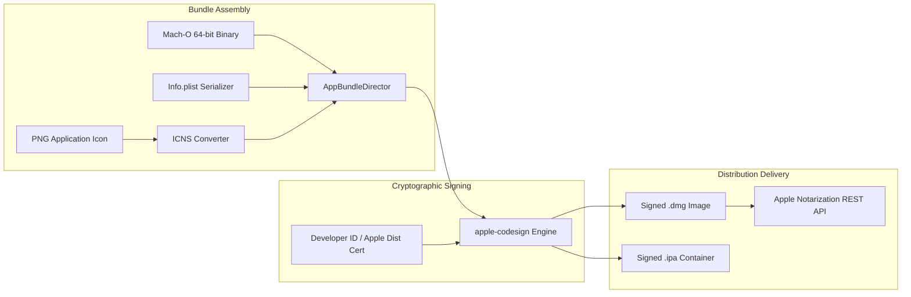

<div align="center">
  <h1>crorust-apple</h1>
  <p><strong>Pure-Rust macOS & iOS App Bundle Assembler, Mach-O Codesigning & Apple Notarization Engine</strong></p>
  <p>
    <a href="https://crates.io/crates/crorust-apple"></a>
    <a href="https://docs.rs/crorust-apple"></a>
    
  </p>
  <p>
    Part of the <a href="https://crorust.com"><strong>CroRust Cross-Platform Build Engine</strong></a>.
  </p>
</div>

---

## Overview

`crorust-apple` packages Mach-O binaries into production-ready macOS application bundles (`.app`), signed Apple Disk Images (`.dmg`), and iOS Application Packages (`.ipa`) **directly from Linux, Windows, or macOS**.

It bypasses Xcode GUI wrappers, `codesign`, `security`, and `create-dmg` by driving pure-Rust cryptography and Apple's official REST APIs.



---

## Core Features

- **Multi-Host Apple Packaging**: Assemble and sign macOS and iOS applications on Linux and Windows workstations without requiring a macOS machine.
- **Mach-O Binary Signing**: Injects code directories, requirements blobs, and PKCS#7 signatures using pure-Rust `apple-codesign`.
- **Pure-Rust ICNS Conversion**: Encodes PNG bitmaps into native Apple Icon Image format (`.icns`) across all required retina and standard resolutions.
- **Apple Notarization REST Client**: Authenticates using App Store Connect API keys (JWT), uploads packages, and polls for cryptographic ticket stapling.
- **Pure-Rust DMG Disk Images**: Creates customized Apple Disk Images (`.dmg`) with volume layouts and licenses.

---

## Quickstart

Add `crorust-apple` to your `Cargo.toml`:

```toml
[dependencies]
crorust-apple = "0.0.1"
```

### Programmatic App Bundle Creation Example

```rust
use crorust_apple::bundle::{assemble_darwin_package, DarwinPackageSpec, DarwinPlatform};
use std::path::PathBuf;

fn create_macos_app() -> anyhow::Result<()> {
    let spec = DarwinPackageSpec {
        bundle_name: "MyApp".to_string(),
        bundle_identifier: "com.example.myapp".to_string(),
        executable_path: PathBuf::from("target/x86_64-apple-darwin/release/myapp"),
        platform: DarwinPlatform::MacOs,
        version: "1.0.0".to_string(),
        output_dir: PathBuf::from("target/dist"),
        icon_path: Some(PathBuf::from("assets/icon.png")),
        entitlements_path: None,
    };

    assemble_darwin_package(&spec)?;
    Ok(())
}
```

---

## Architectural Documentation

For full cross-compilation guides, sysroot management, and multi-platform orchestration:
- [**CroRust Official Website**](https://crorust.com)
- [**API Documentation on docs.rs**](https://docs.rs/crorust-apple)
- [**CroRust GitHub Repository**](https://github.com/adi1ahmad/crorust)

---

## License

Licensed under the [GNU Affero General Public License v3.0 (AGPL-3.0-only)](https://github.com/adi1ahmad/crorust/blob/main/LICENSE).
