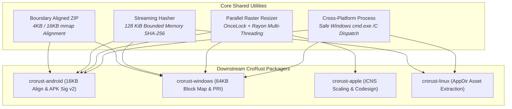

<div align="center">
  <h1>crorust-common</h1>
  <p><strong>Core Zero-Copy Packaging, Aligned ZIP Streaming & Cryptographic Primitives</strong></p>
  <p>
    <a href="https://crates.io/crates/crorust-common"></a>
    <a href="https://docs.rs/crorust-common"></a>
    
  </p>
  <p>
    Part of the <a href="https://crorust.com"><strong>CroRust Cross-Platform Build Engine</strong></a>.
  </p>
</div>

---

## Overview

`crorust-common` provides shared cryptographic, archive streaming, and image processing primitives used across all platform packaging engines in CroRust.

It focuses on **zero-copy memory mapping performance**, **fixed-memory streaming verification**, and **cross-platform host portability** across Linux, macOS, and Windows.



---

## Core Features

- **Boundary Aligned ZIP Streams**: Writes ZIP entries with guaranteed physical byte alignment (e.g. 4096 or 16384 bytes), enabling Android zygote and Windows app runtime zero-copy memory mapping (`mmap`).
- **Bounded-Memory Streaming Hasher**: Calculates SHA-256 digests in 128 KiB NVMe cluster-aligned chunks, keeping peak RAM consumption strictly below 128 KiB even when processing multi-gigabyte distribution packages.
- **Thread-Safe Raster Resizer**: High-throughput bitmap scaling powered by Rayon and `std::sync::OnceLock<DynamicImage>`, avoiding image re-decoding across batch icon generation.
- **Cross-Platform Process Dispatch**: Automatically handles Windows batch script execution (`.bat` / `.cmd` via `cmd.exe /C`) while dispatching directly on POSIX environments.
- **Zip Slip Defense**: Archive extraction routines enforcing strict canonical path containment and safe symlink resolution.

---

## Quickstart

Add `crorust-common` to your `Cargo.toml`:

```toml
[dependencies]
crorust-common = "0.0.1"
```

### Streaming Checksum Example

```rust
use crorust_common::hash_file_streaming;
use std::path::Path;

fn verify_package() -> anyhow::Result<()> {
    let digest = hash_file_streaming(Path::new("target/app.apk"))?;
    println!("SHA-256 Digest: {}", digest);
    Ok(())
}
```

---

## Architectural Documentation

For full cross-compilation guides, sysroot management, and multi-platform orchestration:
- [**CroRust Official Website**](https://crorust.com)
- [**API Documentation on docs.rs**](https://docs.rs/crorust-common)
- [**CroRust GitHub Repository**](https://github.com/adi1ahmad/crorust)

---

## License

Licensed under the [GNU Affero General Public License v3.0 (AGPL-3.0-only)](https://github.com/adi1ahmad/crorust/blob/main/LICENSE).
