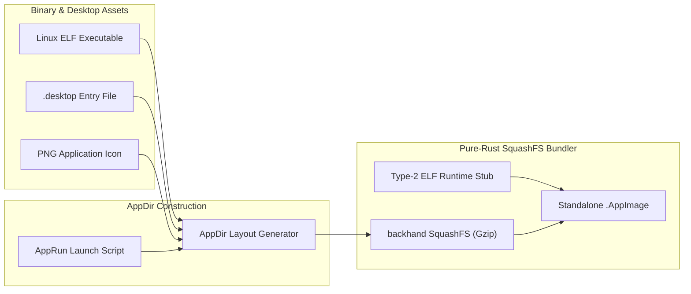

<div align="center">
  <h1>crorust-linux</h1>
  <p><strong>Pure-Rust Linux AppDir Assembler & SquashFS Type-2 AppImage Packaging Engine</strong></p>
  <p>
    <a href="https://crates.io/crates/crorust-linux"></a>
    <a href="https://docs.rs/crorust-linux"></a>
    
  </p>
  <p>
    Part of the <a href="https://crorust.com"><strong>CroRust Cross-Platform Build Engine</strong></a>.
  </p>
</div>

---

## Overview

`crorust-linux` packages Linux ELF binaries, desktop metadata, and icons into portable **Type-2 AppImages** and **AppDirs** **directly in pure Rust**, with no requirement for system `mksquashfs`, Docker, or `linuxdeploy`.

It utilizes `backhand` for cross-platform SquashFS compression, enabling developers on Windows, macOS, and Linux to build bit-for-bit identical AppImage distribution binaries.



---

## Core Features

- **Multi-Host Linux Packaging**: Build functional Linux AppImages on Windows or macOS workstations without running Linux virtual machines.
- **Pure-Rust SquashFS Generation**: Powered by `backhand >= 0.25`, abstracting Unix and Windows filesystem semantics cleanly.
- **No Native Link Conflicts**: Defaults to pure-Rust Gzip compression (`zlib-rs`), requiring zero C compilers and preventing `liblzma-sys` symbol collisions.
- **Type-2 AppImage Launcher Stub**: Embeds a clean-room Type-2 ELF runtime stub that auto-mounts the embedded SquashFS payload via FUSE or extracts to temporary directories.
- **System Toolchain Acceleration**: Seamlessly accelerates packaging via system `mksquashfs` when available, while retaining 100% pure-Rust fallback in air-gapped environments.

---

## Quickstart

Add `crorust-linux` to your `Cargo.toml`:

```toml
[dependencies]
crorust-linux = "0.0.1"
```

### Programmatic AppImage Creation Example

```rust
use crorust_linux::appimage::{assemble_appimage, LinuxPackageSpec};
use std::path::PathBuf;

fn create_appimage() -> anyhow::Result<()> {
    let spec = LinuxPackageSpec {
        app_name: "myapp".to_string(),
        executable_path: PathBuf::from("target/x86_64-unknown-linux-gnu/release/myapp"),
        desktop_file_path: PathBuf::from("assets/myapp.desktop"),
        icon_path: PathBuf::from("assets/icon.png"),
        output_appimage_path: PathBuf::from("target/dist/MyApp-x86_64.AppImage"),
    };

    assemble_appimage(&spec)?;
    Ok(())
}
```

---

## Architectural Documentation

For full cross-compilation guides, sysroot management, and multi-platform orchestration:
- [**CroRust Official Website**](https://crorust.com)
- [**API Documentation on docs.rs**](https://docs.rs/crorust-linux)
- [**CroRust GitHub Repository**](https://github.com/adi1ahmad/crorust)

---

## License

Licensed under the [GNU Affero General Public License v3.0 (AGPL-3.0-only)](https://github.com/adi1ahmad/crorust/blob/main/LICENSE).
