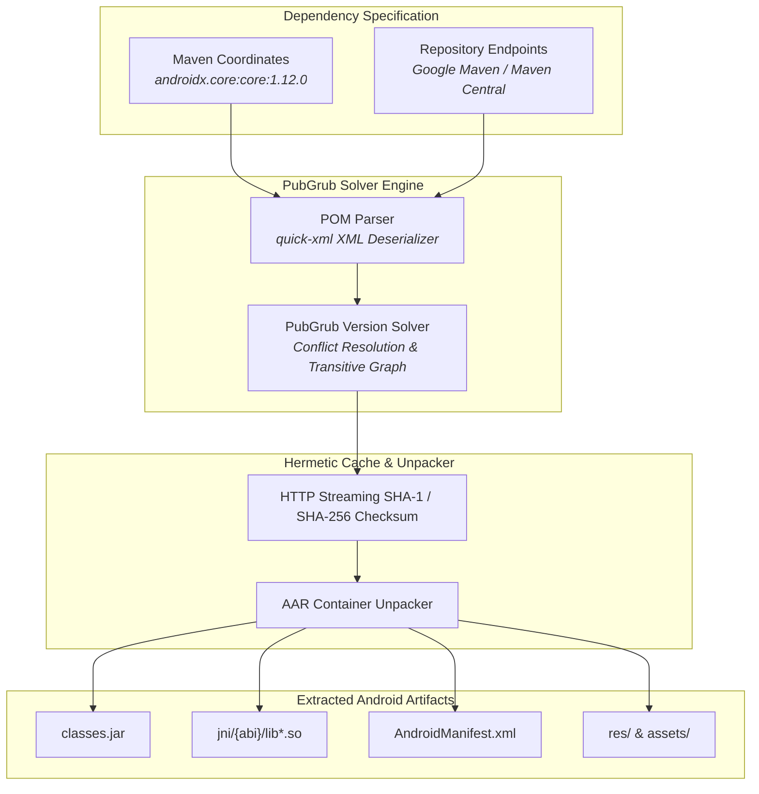

<div align="center">
  <h1>crorust-mvn</h1>
  <p><strong>Pure-Rust PubGrub Maven Dependency Resolver & Android AAR Extraction Engine</strong></p>
  <p>
    <a href="https://crates.io/crates/crorust-mvn"></a>
    <a href="https://docs.rs/crorust-mvn"></a>
    
  </p>
  <p>
    Part of the <a href="https://crorust.com"><strong>CroRust Cross-Platform Build Engine</strong></a>.
  </p>
</div>

---

## Overview

`crorust-mvn` is a standalone, pure-Rust dependency resolution and artifact extraction engine for Maven ecosystems. It allows Rust applications and mobile toolchains to resolve Java and Android dependencies without running the JVM, Gradle daemons, or Maven CLI.

It drives the state-of-the-art **PubGrub version-solving algorithm** across Google Maven and Maven Central repositories to download, verify, and unpack `.aar` and `.jar` libraries.



---

## Core Features

- **Pure-Rust PubGrub Algorithm**: Resolves transitive dependency trees, version constraints, and ranges with clear conflict diagnostics.
- **Gradle-Free Android Packaging**: Extracts `.aar` packages to isolate bytecode, JNI native libraries, and resource manifests for direct consumption by the CroRust compiler pipeline.
- **Multi-Repository Federation**: Concurrently queries Google Maven (`maven.google.com`), Maven Central (`repo1.maven.org`), and authenticated enterprise mirrors.
- **Hermetic Caching**: Validates artifacts using cryptographic checksums (SHA-1 and SHA-256) and stores them in isolated scoped cache tiers.

---

## Quickstart

Add `crorust-mvn` to your `Cargo.toml`:

```toml
[dependencies]
crorust-mvn = "0.0.1"
```

### Dependency Resolution Example

```rust
use crorust_mvn::resolver::{MavenDependencyResolver, DependencyCoordinate};
use std::path::PathBuf;

fn resolve_androidx() -> anyhow::Result<()> {
    let resolver = MavenDependencyResolver::new(PathBuf::from(".cache/crorust/mvn"));
    
    let coordinate = DependencyCoordinate::parse("androidx.appcompat:appcompat:1.6.1")?;
    let resolved_artifacts = resolver.resolve_transitive(&[coordinate])?;

    for artifact in resolved_artifacts {
        println!("Resolved: {} at {:?}", artifact.coordinate, artifact.local_path);
    }
    Ok(())
}
```

---

## Architectural Documentation

For full cross-compilation guides, sysroot management, and multi-platform orchestration:
- [**CroRust Official Website**](https://crorust.com)
- [**API Documentation on docs.rs**](https://docs.rs/crorust-mvn)
- [**CroRust GitHub Repository**](https://github.com/adi1ahmad/crorust)

---

## License

Licensed under the [GNU Affero General Public License v3.0 (AGPL-3.0-only)](https://github.com/adi1ahmad/crorust/blob/main/LICENSE).
