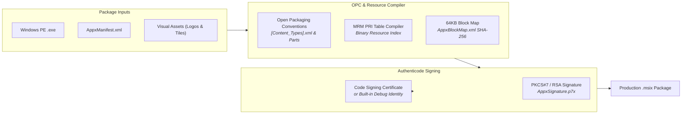

<div align="center">
  <h1>crorust-windows</h1>
  <p><strong>Pure-Rust Windows MSIX Packaging, Open Packaging Conventions & Authenticode Signing Engine</strong></p>
  <p>
    <a href="https://crates.io/crates/crorust-windows"></a>
    <a href="https://docs.rs/crorust-windows"></a>
    
  </p>
  <p>
    Part of the <a href="https://crorust.com"><strong>CroRust Cross-Platform Build Engine</strong></a>.
  </p>
</div>

---

## Overview

`crorust-windows` packages Windows PE binaries (`.exe`), assets, and manifests into production-ready Microsoft Store and enterprise Windows Application Packages (`.msix`) **directly from Linux, macOS, or Windows**.

It replaces proprietary Windows SDK utilities (`MakeAppx.exe`, `MakePri.exe`, `signtool.exe`) with pure-Rust binary format encoders and cryptographic signers.



---

## Core Features

- **Multi-Host Windows Packaging**: Build signed MSIX packages on Linux CI runners or macOS workstations without Windows virtual machines or Wine.
- **Open Packaging Conventions (OPC)**: Conforms to ECMA-376 / ISO-29500 container standards with valid package relationships and content type mappings.
- **64KB Block Map Calculation**: Computes byte-exact 64KB block digests for `AppxBlockMap.xml`, enabling zero-reallocation differential updates by the Windows OS installer.
- **Modern Resource Index (`.pri`) Table Builder**: Compiles binary Package Resource Index files (`resources.pri`) required for Windows shell icon and tile indexing.
- **Authenticode Digital Signing**: Signs MSIX packages according to Microsoft specifications, emitting `AppxSignature.p7x`.
- **Zero-Config Built-in Debug Identity**: Bundles an embedded RSA2048 debug identity for immediate local installation on Windows developer machines without generating certificates.

---

## Quickstart

Add `crorust-windows` to your `Cargo.toml`:

```toml
[dependencies]
crorust-windows = "0.0.1"
```

### Programmatic MSIX Creation Example

```rust
use crorust_windows::package::{assemble_msix_package, WindowsPackageSpec};
use std::path::PathBuf;

fn create_msix() -> anyhow::Result<()> {
    let spec = WindowsPackageSpec {
        package_name: "MyCompany.MyApp".to_string(),
        publisher: "CN=MyCompany".to_string(),
        version: "1.0.0.0".to_string(),
        executable_path: PathBuf::from("target/x86_64-pc-windows-msvc/release/myapp.exe"),
        manifest_path: PathBuf::from("AppxManifest.xml"),
        output_msix_path: PathBuf::from("target/dist/myapp.msix"),
        signing_cert_pem: None, // Uses built-in debug certificate
    };

    assemble_msix_package(&spec)?;
    Ok(())
}
```

---

## Architectural Documentation

For full cross-compilation guides, sysroot management, and multi-platform orchestration:
- [**CroRust Official Website**](https://crorust.com)
- [**API Documentation on docs.rs**](https://docs.rs/crorust-windows)
- [**CroRust GitHub Repository**](https://github.com/adi1ahmad/crorust)

---

## License

Licensed under the [GNU Affero General Public License v3.0 (AGPL-3.0-only)](https://github.com/adi1ahmad/crorust/blob/main/LICENSE).
