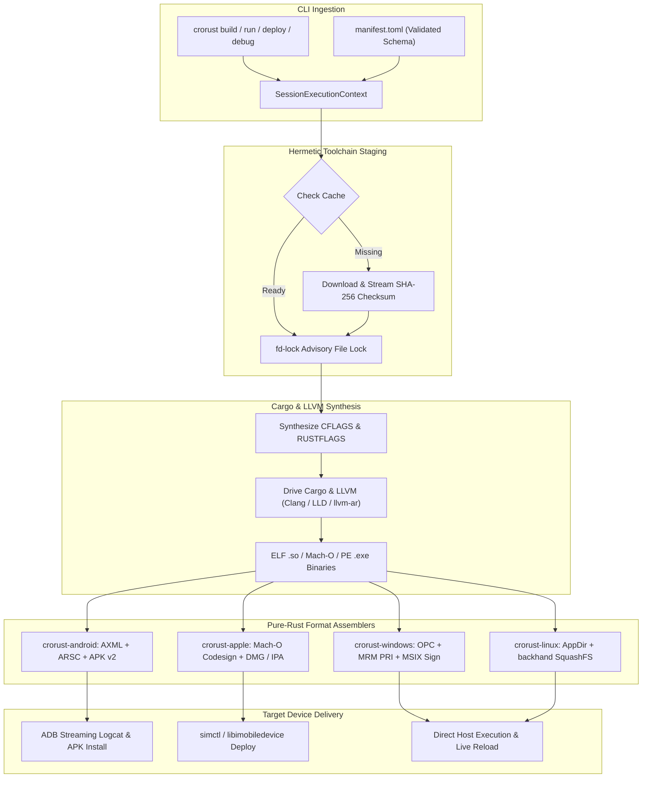

<div align="center">
  <h1>crorust</h1>
  <p><strong>Universal Cross-Platform Build, Packaging & Signing Engine for Rust Desktop & Mobile Apps</strong></p>
  <p>
    <a href="https://crates.io/crates/crorust"></a>
    <a href="https://docs.rs/crorust"></a>
    <a href="https://github.com/adi1ahmad/crorust/actions"></a>
    
    
  </p>
  <p>
    <a href="https://crorust.com"><strong>Official Website (crorust.com)</strong></a> ·
    <a href="https://docs.rs/crorust"><strong>API Documentation</strong></a> ·
    <a href="https://github.com/adi1ahmad/crorust"><strong>GitHub Repository</strong></a>
  </p>
</div>

---

## Overview

**CroRust (`crorust`)** is an all-in-one cross-platform packaging, compilation, and signing orchestrator for building Rust desktop and mobile applications. It solves the fragmentation of multi-target development through two core principles:

1. **Multi-Host Development**: Engineers developing on Linux, macOS, or Windows workstations run identical commands, inspect identical logs, and use the exact same configuration files without shell wrappers, Docker layers, or proprietary IDE lock-in.
2. **Cross-Target Delivery**: Any workstation can compile, package, and cryptographically sign production-ready distribution packages (`.apk`, `.app`, `.dmg`, `.ipa`, `.msix`, `.AppImage`) for Android, iOS, macOS, Windows, and Linux.

Visit [**crorust.com**](https://crorust.com) for full guides, interactive templates, and platform sysroot documentation.

---

## Why CroRust vs. Traditional Toolchains

Shipping a single Rust codebase across five major operating systems traditionally requires maintaining five distinct toolchains—most of which only run on a specific host operating system. `crorust` replaces external toolchain wrappers with pure-Rust binary format assemblers:

| Target Platform | Traditional Requirements | With CroRust (`crorust`) |
| :--- | :--- | :--- |
| **Android** | Android Studio, Gradle Daemon, `aapt2`, `apksigner`, JVM | `crorust build -p android` (pure Rust AXML/ARSC & APK Sig v2) |
| **iOS** | macOS host, Xcode GUI, CocoaPods, `codesign` | `crorust build -p ios` (buildable from Linux, Windows, or macOS) |
| **macOS** | macOS host, Xcode, `create-dmg`, Apple notarytool | `crorust build -p macos --format dmg` (pure Rust Mach-O signing & REST notary) |
| **Windows** | Windows host, Visual Studio, Windows SDK, `MakeAppx`, `signtool` | `crorust build -p windows` (pure Rust OPC, MRM PRI & PKCS#7 signer) |
| **Linux** | `linuxdeploy`, `mksquashfs`, desktop runtime dependencies | `crorust build -p linux` (pure Rust AppDir builder & backhand SquashFS) |

---

## Build & Packaging Pipeline



---

## Installation

### From crates.io via Cargo
```bash
cargo install crorust --locked
```

### From Git Repository
```bash
cargo install --git https://github.com/adi1ahmad/crorust crorust --locked
```

### Nix Flakes
```bash
nix profile add github:adi1ahmad/crorust
```

---

## Command-Line Reference

```bash
# Verify host workstation environment and installed toolchains
crorust i

# Scaffold a new multi-platform Rust project
crorust template init my_app

# Compile and package for Android (builds signed .apk)
crorust build -p android

# Build, deploy to connected Android phone/emulator, and stream logcat
crorust run -p android

# Compile and sign Windows MSIX package with built-in debug certificate
crorust build -p windows

# Compile macOS application bundle and signed DMG disk image
crorust build -p macos --format dmg

# Compile standalone Linux Type-2 AppImage
crorust build -p linux

# Interactive LLDB debugging session with automatic target port-forwarding
crorust debug -p android

# Manage hermetic platform SDK cache
crorust cache status
crorust cache clean
```

---

## Architectural Guide Suite

The complete CroRust architectural documentation is accessible online at [**crorust.com**](https://crorust.com) and embedded directly into the Rustdoc documentation modules (`crorust::docs`):

| Guide | Description | Reference Link |
| :--- | :--- | :--- |
| **System Overview** | Multi-host philosophy, cross-compilation tiers, LLVM wiring | [Documentation](https://crorust.com) |
| **Toolchains & Sysroots** | Hermetic SDK acquisition, SHA-256 streaming, NDK & Windows sysroots | [Documentation](https://crorust.com) |
| **Packaging Internals** | Deep-dive into AXML, ARSC, OPC block maps, and AppImage stubs | [Documentation](https://crorust.com) |
| **Device Controller** | ADB transport, `simctl`, LLDB remote debugging integration | [Documentation](https://crorust.com) |
| **Configuration Reference** | Full `manifest.toml` schema specification and cascading defaults | [Documentation](https://crorust.com) |
| **Project Templates** | Pre-configured application scaffolding and Cargo workspace setups | [Documentation](https://crorust.com) |
| **Cache Scope & CI** | Project-local (`.cache/`) vs. global (`~/.cache/`) reclamation in CI | [Documentation](https://crorust.com) |

---

## License

CroRust is licensed under the [GNU Affero General Public License v3.0 (AGPL-3.0-only)](https://github.com/adi1ahmad/crorust/blob/main/LICENSE).
