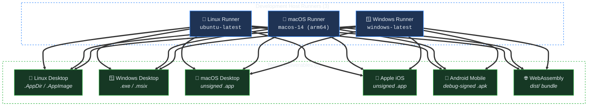

# Hermetic Caching & Continuous Integration (CI)

## 1. Hermetic Caching Architecture

When cross-compiling, build performance and reproducibility depend on how toolchains, sysroots, and intermediate compilation artifacts are stored. `crorust` supports two caching scopes:

| Cache Scope | Location | Primary Use Case | Advantages |
| :--- | :--- | :--- | :--- |
| **Project-Local** *(Default)* | `<workspace_root>/.cache/crorust/` | Day-to-day development; CI uses `CRORUST_CACHE_DIR` for a single OS-independent path | Hermetic isolation: deleting the project folder cleans 100% of artifacts without leaving orphaned files on the host. |
| **Global** | Linux: `~/.cache/crorust/`<br/>macOS: `~/Library/Caches/crorust/`<br/>Windows: `%LOCALAPPDATA%\crorust\` | Workstations with limited disk space | Shared toolchains across multiple projects; downloads JDK, NDK, and SDKs only once. |

To toggle between scopes, configure `[toolchain] cache_scope` in `manifest.toml` or pass the `--global-cache` or `--project-cache` CLI flag:

```sh
# Force global cache usage for a single command
crorust build --global-cache -p android
```

---

## 2. Cache Maintenance & Pruning

Over time, building multiple targets and updating SDKs accumulates disk usage. `crorust cache` provides subcommands to inspect and clean the cache:

```sh
# Inspect disk usage and breakdown by category (tools, sysroots, cargo target)
crorust cache info

# Clean project intermediate artifacts and packaging outputs
crorust cache clean

# Clean everything including cached sysroots and compilers
crorust cache clean --all

# Prune stale downloads (.part files) and orphaned file locks
crorust cache prune
```

### Safety Guarantees
- `crorust cache clean` never deletes source code or tracked files.
- `crorust cache prune` checks process IDs of active builds before removing locks, preventing accidental interference with concurrent running builds.

---

## 3. The 18-Platform Continuous Integration Matrix

To guarantee that `crorust` works identically on all three workstation operating systems (Linux, macOS, and Windows) when targeting all six deployment platforms, the CI workflow ([`.github/workflows/ci.yml`](../.github/workflows/ci.yml)) executes the full **$3 \times 6 = 18$ cross-platform matrix**:



### The 18 Combinations Table

| Host Runner | Target Platform | Architecture | Output Package | CI Verification Step |
| :--- | :--- | :--- | :--- | :--- |
| **Linux** (`ubuntu-latest`) | `linux` | `x64` | `ruxt-linux-x64.AppDir` | AppDir/ELF + native launch (Linux host) |
| | `android` | `arm64` | `ruxt-android-arm64.apk` | APK structure (dex/AXML/resources) |
| | `windows` | `x64` | `ruxt-windows-x64.exe` | PE header + size |
| | `web` | `x64` | `ruxt-web-dist/` | index.html + wasm presence |
| | `macos` | `arm64` | `ruxt-macos-arm64.app` | Mach-O + Info.plist |
| | `ios` | `arm64` | `ruxt-ios-arm64.app` | Mach-O + Info.plist |
| **macOS** (`macos-14`) | `macos` | `arm64` | `ruxt-macos-arm64.app` | AppDir/ELF + native launch (Linux host) |
| | `ios` | `arm64` | `ruxt-ios-arm64.app` | Mach-O + Info.plist |
| | `android` | `arm64` | `ruxt-android-arm64.apk` | APK structure (dex/AXML/resources) |
| | `web` | `arm64` | `ruxt-web-dist/` | index.html + wasm presence |
| | `linux` | `x64` | `ruxt-linux-x64.AppDir` | AppDir/ELF structure |
| | `windows` | `x64` | `ruxt-windows-x64.exe` | PE header + size |
| **Windows** (`windows-latest`) | `windows` | `x64` | `ruxt-windows-x64.exe` | AppDir/ELF + native launch (Linux host) |
| | `android` | `arm64` | `ruxt-android-arm64.apk` | APK structure (dex/AXML/resources) |
| | `web` | `x64` | `ruxt-web-dist/` | index.html + wasm presence |
| | `linux` | `x64` | `ruxt-linux-x64.AppDir` | AppDir/ELF structure |
| | `macos` | `arm64` | `ruxt-macos-arm64.app` | Mach-O + Info.plist |
| | `ios` | `arm64` | `ruxt-ios-arm64.app` | Mach-O + Info.plist |

---

## 4. CI Caching

GitHub Actions cache storage is capped at **10 GB per repository** (LRU eviction above that).
The 3x6 dogfood matrix cannot cache every toolchain and target directory, so the design is:

- **One toolchain cache per OS + target platform**, stored in a workspace-local directory via
  `CRORUST_CACHE_DIR`. This avoids the macOS `~/Library/Caches` vs `~/.cache` mismatch entirely.
- **Restore on every run, save on `main` only** (`save-if` in rust-cache, a guarded
  `actions/cache/save` for the tool cache). Pull requests restore `main`'s caches and never
  create PR-scoped duplicates.
- **Prune raw downloads** (`<cache>/download`) before saving; extracted tools keep their
  `.complete` marker and remain valid.
- Cache keys include `catalog.rs`, `i.rs` and `manifest.toml`, so tool/version changes
  invalidate the cache instead of silently reusing stale SDKs.

```yaml
env:
  CRORUST_CACHE_DIR: ${{ github.workspace }}/.cache/crorust-tools

steps:
  - uses: actions/cache/restore@v4
    id: tools
    with:
      path: ${{ env.CRORUST_CACHE_DIR }}
      key: crorust-tools-v2-${{ runner.os }}-${{ matrix.target-platform }}-${{ hashFiles('crates/crorust/src/download/catalog.rs', 'crates/crorust/src/commands/i.rs', 'templates/crorust.ruxt/manifest.toml') }}
      restore-keys: |
        crorust-tools-v2-${{ runner.os }}-${{ matrix.target-platform }}-

  # ... build ...

  - uses: actions/cache/save@v4
    if: github.ref == 'refs/heads/main' && steps.tools.outputs.cache-hit != 'true'
    with:
      path: ${{ env.CRORUST_CACHE_DIR }}
      key: ${{ steps.tools.outputs.cache-primary-key }}
```

Because `crorust` validates cached archives with `.complete` markers and streaming SHA-256
digests, a cache hit is guaranteed to be uncorrupted and ready for immediate compilation.

### 4.1 Matrix and toolchain policy

- The full 18-combination matrix runs across the three runner operating systems
  (Ubuntu, macOS, and Windows) in `.github/workflows/ci.yml`.
- The three host jobs are thin wrappers around `.github/actions/dogfood-build/action.yml`;
  the build, cache, verification, staging and upload logic lives in that one composite action.
- The `crorust` workspace is built with stable Rust; the reference template is built with the
  **pinned** nightly from `templates/crorust.ruxt/rust-toolchain.toml` (`RUST_NIGHTLY` in
  `ci.yml` must match it). This is why CI can use the template's `-Z*` and wasm cfg flags.
- Dogfood builds use `--release`. Verification is structural (ELF/PE/Mach-O headers,
  `Info.plist`, APK entries, WASM output, AppDir layout); it does **not** perform code-signing
  or APK-signature audits.

### 4.2 CI Artifact Taxonomy & Staging Convention

CI distinguishes between the host toolchain executables and the cross-compiled application packages:

| Tier | Artifact Classification | Naming Pattern | Example |
| :--- | :--- | :--- | :--- |
| **Tier 2** | Host CLI Executables | `crorust-${host_slug}` | `crorust-linux-x64` |
| **Tier 4** | Target Application Packages | `ruxt-${target_platform}-${target_arch}-via-${host_slug}` | `ruxt-ios-arm64-via-linux-x64` |

- **`ruxt`**: Identifies the reference application package produced from `templates/crorust.ruxt`.
- **`-via-${host_slug}`**: Captures the builder host that performed the cross-compilation, preventing artifact name collisions across concurrent matrix runners while ensuring full provenance.
