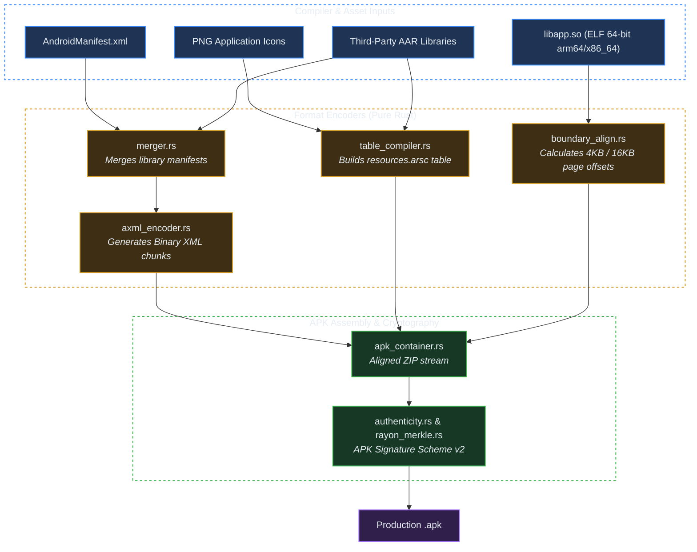

# Crate: `crorust-android` (Pure-Rust Android Packaging & Signer v2)

## 1. Overview & Architectural Role

`crorust-android` compiles raw ELF shared objects (`.so`) and plaintext manifests into production `.apk` and `.aab` packages without delegating to `aapt2`, Gradle, `zipalign`, or `apksigner`.



---

## 2. Binary XML Encoding (AXML)

Android zygote and system services reject plaintext XML files. `crorust-android` encodes manifests into the binary chunk stream format expected by the Android framework:

```
┌────────────────────────────────────────────────────────┐
│ Chunk Header: RES_XML_TYPE (0x0003)                   │
├────────────────────────────────────────────────────────┤
│ String Pool Chunk: RES_STRING_POOL_TYPE (0x0001)       │
│ - Global UTF-8 string pool deduplicating all names     │
├────────────────────────────────────────────────────────┤
│ Resource Map Chunk: RES_XML_RESOURCE_MAP_TYPE (0x0180) │
│ - Maps string pool indices to framework attribute IDs │
├────────────────────────────────────────────────────────┤
│ Namespace Start Chunk: RES_XML_START_NAMESPACE (0x0100)│
│ - "android" -> "http://schemas.android.com/apk/res/..."│
├────────────────────────────────────────────────────────┤
│ Start Element Chunks: RES_XML_START_ELEMENT (0x0102)   │
│ - Tag: <manifest>, <application>, <activity>           │
│ - Attributes: name, exported, theme, launchMode        │
├────────────────────────────────────────────────────────┤
│ End Element Chunks: RES_XML_END_ELEMENT (0x0103)       │
└────────────────────────────────────────────────────────┘
```

---

## 3. Dynamic Page Alignment (`mmap`)

The Android dynamic linker loads uncompressed native libraries (`.so`) directly out of the APK container using the `mmap()` syscall. To enable this without runtime page faults, the payload data must begin at a file offset that aligns to the target CPU's page size:
- **4096 bytes (4KB)**: ARMv7 and legacy 64-bit Android kernels.
- **16384 bytes (16KB)**: Android 15+ kernels with 16KB page support. Aligning to 16KB satisfies both 4KB and 16KB page configurations.

`AlignedArchiveSink` calculates the local file header length:
$$\text{Local Header Size} = 30 + \text{Length of Filename} + \text{Length of Extra Field}$$
It inserts padding bytes into the ZIP local header extra field (`0xd935` Android alignment tag) to guarantee zero-copy memory mapping.

---

## 4. APK Signature Scheme v2 (APK Sig Block 42)

Scheme v2 protects against ZIP metadata tampering by signing the entire binary file.

```
┌────────────────────────────────────────────────────────┐
│ Section 1: Local File Headers & Entry Payloads         │
├────────────────────────────────────────────────────────┤
│ Section 2: APK Signing Block (Magic: "APK Sig Block 42")│
│ - Size of Block (8 bytes)                              │
│ - ID-Value Pair (ID 0x7109871a = Signature Scheme v2)  │
│   ├── Signer Sequence                                  │
│   │   ├── Signed Data (Digests of Sec 1, 3, 4)         │
│   │   ├── X.509 Certificate (DER-encoded ASN.1)        │
│   │   └── Cryptographic Signature (RSA PKCS#1 v1.5)    │
│ - Size of Block (8 bytes)                              │
│ - Magic Bytes: "APK Sig Block 42"                      │
├────────────────────────────────────────────────────────┤
│ Section 3: Central Directory                           │
├────────────────────────────────────────────────────────┤
│ Section 4: End of Central Directory (EOCD)             │
│ (Offset to Central Directory adjusted to skip Sec 2)   │
└────────────────────────────────────────────────────────┘
```

### Merkle Tree Hashing with Rayon
To minimize signing latency on multi-gigabyte games or media applications, `crorust-android` splits Section 1, Section 3, and Section 4 into 1MB chunks. Parallel Rayon worker threads compute SHA-256 digests of each chunk concurrently. The leaf hashes are concatenated and hashed into a final root digest, which is signed by the developer's private key.
