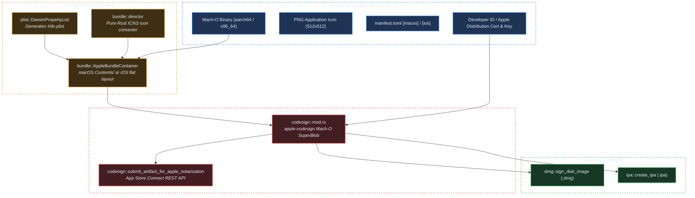

# Crate: `crorust-apple` (macOS/iOS Bundles, Codesigning & Notarization)

## 1. Overview & Architectural Role

`crorust-apple` provides end-to-end application packaging and cryptographic signing for macOS and iOS without requiring macOS hardware, Xcode, or Apple proprietary command-line tools.



---

## 2. Darwin Application Bundle Layouts

macOS and iOS enforce distinct directory conventions:

### macOS Application Bundle (`MyApp.app/`)
macOS bundles use a nested `Contents/` hierarchy:
```
MyApp.app/
└── Contents/
    ├── MacOS/
    │   └── my_app                    # 64-bit Mach-O executable (0o755 permissions)
    ├── Resources/
    │   └── AppIcon.icns              # Multi-resolution ICNS icon (16x16 to 512x512)
    ├── Frameworks/
    │   └── libhelper.dylib           # Dynamic link libraries
    └── Info.plist                    # Bundle metadata (CFBundleIdentifier, etc.)
```

### iOS Application Bundle (`MyApp.app/`)
iOS bundles use a flat structure without `Contents/`:
```
MyApp.app/
├── my_app                            # Mach-O executable
├── Info.plist                        # Bundle metadata
├── AppIcon60x60@2x.png               # Pre-scaled iOS icons
├── embedded.mobileprovision          # Apple mobile provisioning profile
└── _CodeSignature/
    └── CodeResources                 # XML plist containing resource SHA-256 hashes
```

---

## 3. Pure-Rust Mach-O Codesigning

Apple's kernel verifies executables by inspecting the `LC_CODE_SIGNATURE` load command at runtime. `crorust-apple` utilizes `apple-codesign` to build the required signature SuperBlob in pure Rust:

```
┌────────────────────────────────────────────────────────┐
│ Mach-O Binary Header (64-bit, CPU_TYPE_ARM64 / X86_64) │
├────────────────────────────────────────────────────────┤
│ __TEXT Segment (Executable code pages)                 │
├────────────────────────────────────────────────────────┤
│ __DATA Segment                                         │
├────────────────────────────────────────────────────────┤
│ LC_CODE_SIGNATURE Load Command (Points to SuperBlob)   │
├────────────────────────────────────────────────────────┤
│ Code Signature SuperBlob (Magic: 0xfade0cc0)          │
│ ├── CSSLOT_CODEDIRECTORY (0x0000)                      │
│ │   └── SHA-256 hashes of every 4096-byte code page    │
│ ├── CSSLOT_REQUIREMENTS (0x0002)                       │
│ │   └── Designated Requirement bytecode                │
│ ├── CSSLOT_ENTITLEMENTS (0x0005)                       │
│ │   └── XML Entitlements plist                         │
│ └── CSSLOT_SIGNATURESLOT (0x10000)                     │
│     └── CMS / PKCS#7 Cryptographic Signature Envelope  │
└────────────────────────────────────────────────────────┘
```

Because the signature is computed directly on the Mach-O binary bytes, **this codesigning pipeline runs identically on Linux, Windows, and macOS**.

---

## 4. Apple Notarization REST API

Apple requires all non-App Store macOS software to be notarized by Apple's automated malware scanning service before Gatekeeper will allow it to launch.

`crorust-apple` communicates directly with Apple's REST API:
1. Generates an asymmetric ES256 JSON Web Token (JWT) using the developer's App Store Connect API Key (`AuthKey_XXXXXX.p8`).
2. Submits an HTTP `POST` request to `https://appstoreconnect.apple.com/notary/v2/submissions`.
3. Streams the `.dmg` or `.zip` archive to Apple's Amazon S3 staging bucket.
4. Polls the submission status endpoint until the ticket transitions to `Accepted`.
