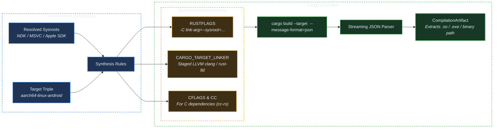

# Crate: Cargo & Cross-Toolchain Driving

## 1. Overview & Systems Philosophy

When invoking Cargo for cross-compilation, standard tutorials advise configuring `.cargo/config.toml` or writing bash wrapper scripts. This approach fails across heterogeneous developer teams:
- Modifying `.cargo/config.toml` contaminates the user's workspace with absolute host paths.
- Shell scripts do not run natively on Windows without Git Bash or WSL.
- Environment variables set in parent shells can bleed into builds and corrupt compiler invocations.

`crorust` bypasses these pitfalls by acting as a **Direct Compiler Driver**. It executes `cargo build` as a child process with an isolated, synthesized environment block.

---

## 2. Environment Variable Synthesis

[`CargoEnvironmentSynthesizer`](../../crates/crorust/src/cargo/synthesizer.rs) injects target-specific configurations:

### 1. Android Targets (`*-linux-android`)
- **Sysroot**: `-C link-arg=--sysroot=<cache>/tools/<host>/ndk/toolchains/llvm/prebuilt/<host>/sysroot`
- **Linker**: Sets `CARGO_TARGET_<TRIPLE>_LINKER` to the NDK Clang binary.
- **C/C++ Dependencies**: When native C libraries (like OpenSSL or FreeType) are compiled via `cc-rs`, `CC` and `CFLAGS` are set so `cc-rs` targets the NDK Bionic libc rather than host glibc.

### 2. Windows Targets from Non-Windows Hosts (`x86_64-pc-windows-msvc`)
- Points `rust-lld` to the staged Windows SDK UCRT and CRT link libraries (`/winsysroot:`).
- Eliminates the requirement for Microsoft Visual Studio C++ build tools on Linux or macOS.

### 3. Apple Targets from Non-macOS Hosts (`*-apple-darwin`, `*-apple-ios`)
- Points `clang` to `MacOSX.sdk` or `iPhoneOS.sdk`.
- Injects framework search paths (`-F <sysroot>/System/Library/Frameworks`).

---

## 3. Streaming Artifact Parsing (`--message-format=json`)

Rather than guessing where Cargo placed the output binary (which varies depending on release mode, workspace structure, and examples), `crorust` executes Cargo with `--message-format=json`:
1. Cargo streams JSON lines to stdout describing compiler tasks.
2. `CargoWorkspaceSession` filters for message type `"compiler-artifact"`.
3. It identifies the primary executable (`CompilationCrateKind::Bin`) or shared library (`CompilationCrateKind::CDylib`).
4. It extracts the exact absolute filesystem path, immediately handing it over to the packaging bundlers.
