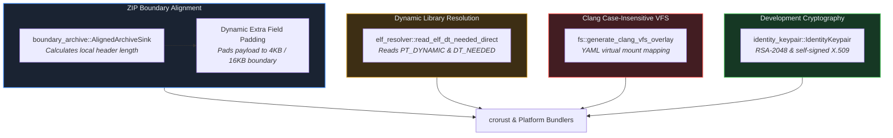

# Crate: `crorust-common` (Cross-Cutting Primitives & Systems Utilities)

## 1. Overview & Architectural Role

`crorust-common` provides low-level systems utilities shared across all platform bundler crates and toolchain drivers.



---

## 2. Dynamic Extra-Field Alignment (`AlignedArchiveSink`)

Operating systems that memory-map native libraries directly out of archives (such as Android's Bionic dynamic linker) require the payload bytes of uncompressed `.so` files to be aligned to OS page boundaries (4096 or 16384 bytes).

Standard ZIP libraries compute alignment on compressed data sizes, but cannot account for the variable-length ZIP Local File Header preceding each file.

[`boundary_archive::AlignedArchiveSink`](../../crates/crorust-common/src/boundary_archive.rs) solves this dynamically:
1. Tracks the current absolute byte position in the output file: $\text{pos}$.
2. Determines the base length of the standard ZIP Local File Header:
   $$\text{base\_header} = 30 + \text{filename.len}()$$
3. Accounts for the 4-byte extra field alignment tag header (`ID` + `Size`).
4. Computes required padding bytes:
   $$\text{unaligned\_offset} = (\text{pos} + \text{base\_header} + 4) \pmod{\text{align}}$$
   $$\text{padding} = (\text{align} - \text{unaligned\_offset}) \pmod{\text{align}}$$
5. Injects the padding bytes into the ZIP Local File Header's extra field. The file data payload begins precisely on the required memory page boundary.

---

## 3. Pure-Rust ELF `DT_NEEDED` Resolver

When packaging native libraries into application bundles (such as an Android APK or Linux AppDir), the bundler must identify which shared libraries the main binary depends on.

[`elf_resolver::read_elf_dt_needed_direct`](../../crates/crorust-common/src/elf_resolver.rs):
1. Reads the ELF 64-bit/32-bit header to find program headers (`e_phoff`).
2. Iterates through program headers to locate the `PT_DYNAMIC` segment.
3. Traverses dynamic entries looking for `DT_NEEDED` tags containing string table offsets.
4. Reads the string table (`DT_STRTAB`) to retrieve library names (e.g. `libc.so`, `libm.so`, `liblog.so`) without calling external tools like `readelf` or `objdump`.

---

## 4. Clang Virtual Filesystem (VFS) Overlays

On macOS and Windows, filesystems are case-insensitive by default. SDK headers frequently contain mixed-case includes like `#include <Foundation/Foundation.h>` or `#include <windows.h>`.

When compiling on Linux (case-sensitive ext4), Clang fails if the file on disk is named `foundation.h` or `Windows.h`.

[`fs::generate_clang_vfs_overlay`](../../crates/crorust-common/src/fs.rs):
1. Scans the sysroot directory tree.
2. Emits a Clang YAML VFS overlay:
   ```yaml
   version: 0
   case-sensitive: false
   roots:
     - name: "/path/to/sysroots/MacOSX.sdk"
       type: directory
       contents:
         - name: "Foundation.h"
           type: file
           external-contents: "/path/to/sysroots/MacOSX.sdk/.../foundation.h"
   ```
3. Passes `-ivfsoverlay` to Clang, enabling case-insensitive header compilation on Linux workstations.
