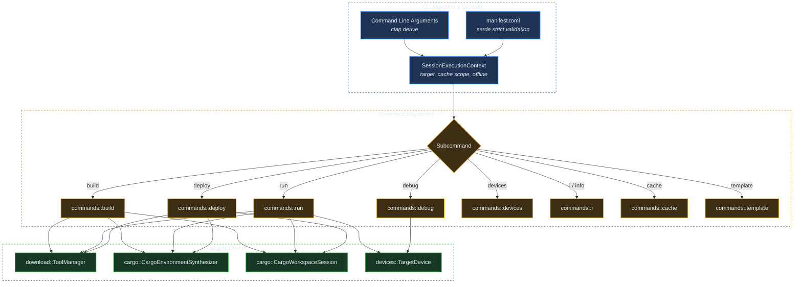

# Crate: `crorust` (CLI & Workflow Orchestrator)

## 1. Overview & Architectural Role

`crates/crorust` serves as the user-facing CLI binary and top-level pipeline coordinator. It interprets command-line flags, parses `manifest.toml`, queries device backends, provisions hermetic SDKs, synthesizes LLVM compiler environments, drives Cargo, and invokes platform bundlers.

---

## 2. Key Modules & Subsystems

### 1. `cli.rs` & `commands/`
`crorust` uses `clap` with derive macros to parse user input. Subcommands are cleanly separated into dedicated modules:
- `commands::build`: Coordinates compilation and packaging without running the artifact.
- `commands::run`: Builds, installs to target device, launches the process, and streams stdout/logcat logs.
- `commands::deploy`: Release-mode equivalent of `run`.
- `commands::debug`: Deploys a debug build and opens an interactive LLDB debugging session via port forwarding.
- `commands::devices`: Discovers and displays connected physical and virtual devices.
- `commands::i`: Audits compilers, linkers, and SDKs. With `--fix`, provisions all missing components automatically.
- `commands::cache`: Manages disk usage, cleaning targets, and pruning orphaned locks.
- `commands::template`: Scaffolds new projects from `templates/crorust.ruxt`.

### 2. `core/`
Encapsulates domain models:
- `target.rs`: Defines `SessionBuildTarget`, `TargetPlatform`, `TargetArch`, and `LinuxLibcVariant`.
- `env.rs`: `SessionExecutionContext` containing immutable session settings.
- `contracts.rs`: Defines the foundational interfaces (`ToolchainProvider`, `BuildEnvironmentSynthesizer`, `PackageAssembler`).

### 3. `download/`
Handles hermetic toolchain acquisition:
- `catalog.rs`: Declarative index of verified tool release archives (Adoptium JDK, Android NDK, Kotlin, Windows SDK).
- `manager.rs`: `ToolManager` implementing cross-process locking (`fd-lock`), streaming SHA-256 checks, and atomic extractions.

### 4. `task.rs`
Provides terminal user feedback:
- Wraps `indicatif` to render multi-line progress bars and activity spinners.
- Silences animation in non-interactive CI environments to keep logs clean.
