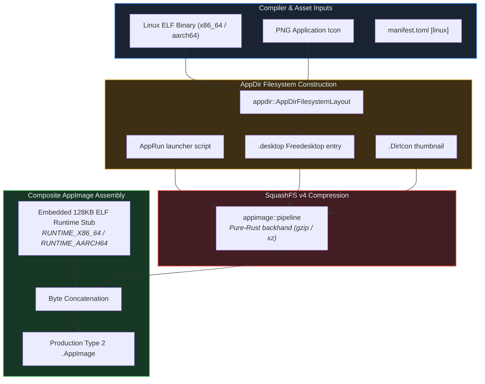

# Crate: `crorust-linux` (Linux AppDir, AppImage & SquashFS)

## 1. Overview & Architectural Role

`crorust-linux` packages Linux executables into standalone, portable distribution formats. Unlike traditional Linux packaging tools (`appimagetool`, `mksquashfs`), `crorust-linux` runs in pure Rust without requiring Linux host tools, root permissions, or FUSE kernel modules.



---

## 2. Type 2 AppImage Composite Binary Specification

A Type 2 AppImage is an ELF executable that embeds its own compressed SquashFS filesystem:

```
┌────────────────────────────────────────────────────────┐
│ Byte 0..7: ELF Magic (\x7fELF...)                      │
│ Byte 8..10: AppImage Magic Bytes (\x41\x49\x02 = "AI\x02")│
│ Byte 11..131071: Precompiled 128KB ELF Runtime Stub    │
├────────────────────────────────────────────────────────┤
│ Byte 131072+: SquashFS v4 Filesystem Image            │
│ Superblock Magic: 'hsqs' (\x68\x73\x71\x73)            │
│ Compression: gzip (fastest launch) or xz (smallest)   │
│ Inodes:                                                │
│   ├── AppRun (0o755 executable permissions)            │
│   ├── MyApp.desktop                                    │
│   ├── .DirIcon                                         │
│   └── MyApp (Compiled Rust binary, 0o755)              │
└────────────────────────────────────────────────────────┘
```

### How the Runtime Stub Mounts the Payload
When a user launches `MyApp.AppImage`:
1. The 128KB runtime stub executes.
2. It inspects its own file size and reads the SquashFS header at offset `131072`.
3. It mounts the embedded SquashFS payload to a temporary directory in `/tmp/.mount_XXXXXX` using FUSE (Filesystem in Userspace).
4. It sets environment variables (`APPDIR`, `OWD`, `PATH`) and executes `AppRun`.
5. When the user exits the application, FUSE unmounts the directory cleanly.

---

## 3. Pure-Rust SquashFS via `backhand`

Traditional packaging runs `mksquashfs`, which requires external C tools and fails on Windows or macOS workstations.

`crorust-linux` uses the pure-Rust `backhand` library:
- Writes SquashFS v4 filesystems directly to memory buffers or disk sinks.
- Preserves Unix file permissions (`0o755` for executables, `0o644` for icons/desktops).
- Supports both gzip and xz compression algorithms.

---

## 4. Dynamic Glibc vs Portable Static Musl

In `manifest.toml`, developers can choose between two libc runtime variants:

```toml
[linux]
# "gnu": Links dynamically against host glibc (supports GTK, WebKit, OpenGL)
# "musl": Statically links against musl libc (runs on Alpine, Debian, RHEL, NixOS)
libc = "gnu"
```

For applications without dynamic C library dependencies, building with `crorust build -p linux --musl` produces an ultra-portable static binary that executes across every Linux kernel version from 3.10 to modern 6.x.
