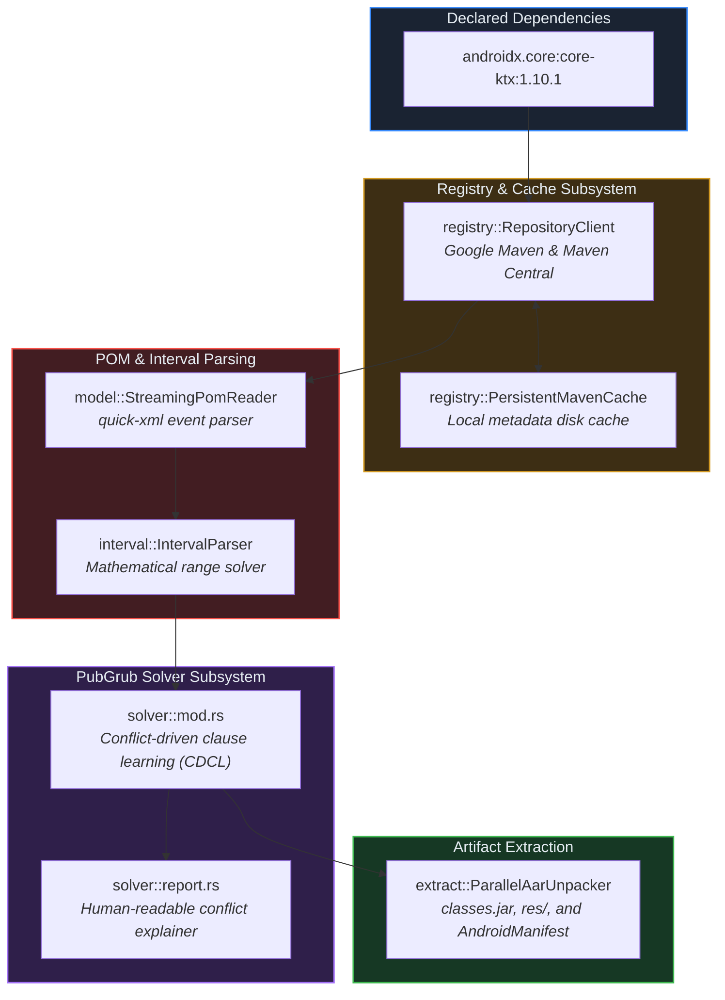

# Crate: `crorust-mvn` (Pure-Rust Maven Dependency Resolution)

## 1. Overview & Architectural Role

`crorust-mvn` solves and downloads Java and Android Maven dependencies (`.aar` and `.jar` libraries) without requiring the Java Virtual Machine, Apache Maven, or Gradle.



---

## 2. Mathematical Version Interval Parsing

Maven dependencies specify version ranges using mathematical interval notation:
- `[1.0, 2.0)`: Version $v \ge 1.0$ and $v < 2.0$.
- `[1.5,)`: Any version $v \ge 1.5$.
- `(,2.0]`: Any version $v \le 2.0$.
- `1.2.3`: Soft requirement for version 1.2.3 (or exact match).

[`interval::IntervalParser`](../../crates/crorust-mvn/src/interval/parser.rs) uses a state machine lexer and token stream to construct `VersionConstraint` objects supporting union, intersection, and endpoint inclusion checks.

---

## 3. The PubGrub Algorithm Adaptation

Traditional dependency solvers (like standard Gradle or Pip) use greedy backtracking. When encountering diamond dependencies ($A \to B \to D$ and $A \to C \to D$), greedy algorithms can degrade into exponential $O(2^n)$ search times or fail with unhelpful error messages.

`crorust-mvn` uses the **PubGrub algorithm**:
1. **Unit Propagation**: Deduces version requirements by tracking mutual exclusions across compatibility clauses.
2. **Conflict Resolution**: When an incompatibility is discovered, PubGrub identifies the root decision variable and learns a new incompatibility clause, jumping directly back to the decision level that caused the conflict.
3. **Actionable Conflict Reports**: If constraints cannot be resolved, [`format_resolution_conflict`](../../crates/crorust-mvn/src/solver/report.rs) emits human-readable explanations:
   ```text
   Because app depends on androidx.core (>= 1.10.0) which depends on androidx.annotation (1.6.0),
   and app depends on androidx.annotation (1.2.0),
   version solving failed.
   ```

---

## 4. Parallel AAR Unpacking

Android Archive (`.aar`) packages are ZIP archives containing:
- `classes.jar`: Compiled JVM bytecode.
- `AndroidManifest.xml`: Library permissions and component descriptors.
- `res/`: Android resources (layouts, drawables, values).
- `jni/<abi>/`: Native shared libraries (`.so`).

[`ParallelAarUnpacker`](../../crates/crorust-mvn/src/extract.rs) distributes extraction across CPU cores using Rayon, staging `.jar` files into the compilation classpath and `.so` libraries into the native linker search paths.
