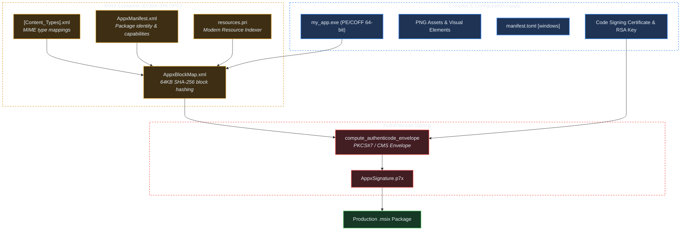

# Crate: `crorust-windows` (MSIX Packaging, Block Maps & Authenticode)

## 1. Overview & Architectural Role

`crorust-windows` implements Windows Modern application packaging and cryptographic signing in pure Rust, removing dependencies on Microsoft Visual Studio, `MakeAppx.exe`, and `SignTool.exe`.



---

## 2. Open Packaging Conventions (OPC) Anatomy

An MSIX container is an uncompressed or deflated ZIP archive structured according to ECMA-376 Open Packaging Conventions:

```
MyApp.msix/
├── [Content_Types].xml               # Declares MIME types for all extensions
├── AppxManifest.xml                  # Identity, capabilities, and visual elements
├── AppxBlockMap.xml                  # 64KB block cryptographic digests
├── resources.pri                     # Binary index for localized assets
├── AppxSignature.p7x                 # Uncompressed Authenticode PKCS#7 signature
└── my_app.exe                        # Windows PE/COFF executable
```

### The 64KB Block Map (`AppxBlockMap.xml`)
Windows AppX Deployment Service does not re-download entire multi-gigabyte packages during updates. Instead, it inspects `AppxBlockMap.xml`:
- Every file in the package is partitioned into contiguous 64KB (`65536` byte) blocks.
- Each block is hashed using SHA-256.
- During updates or streaming installs, the client requests only the modified 64KB blocks over HTTP range requests.

---

## 3. Authenticode PKCS#7 Signature Envelope

Windows validates MSIX packages at install time. If `AppxSignature.p7x` is missing or invalid, installation aborts with `TRUST_E_NOSIGNATURE` (`0x800B0100`).

`crorust-windows` builds the Authenticode envelope in pure Rust:
1. Computes the SHA-256 digest of `AppxBlockMap.xml`.
2. Computes the SHA-256 digest of `AppxManifest.xml`.
3. Computes the SHA-256 digest of `[Content_Types].xml`.
4. Wraps these digests inside an ASN.1 `SpcIndirectDataContent` structure.
5. Signs the structure using an RSA private key with PKCS#7 / CMS padding.
6. Writes the signature as an uncompressed (`CompressionMethod::Stored`) ZIP entry named `AppxSignature.p7x`.

---

## 4. Development Signing & Certificate Export

For local testing on Windows machines:
1. Export the built-in development certificate:
   ```sh
   crorust cert export-debug --platform windows -o crorust-debug.cer
   ```
2. Import the certificate into the Windows **Trusted People** certificate store (requires admin):
   ```powershell
   Import-Certificate -FilePath crorust-debug.cer -CertStoreLocation Cert:\LocalMachine\TrustedPeople
   ```
3. Packages built with `crorust build --platform windows` can now be double-clicked and installed without warnings.
