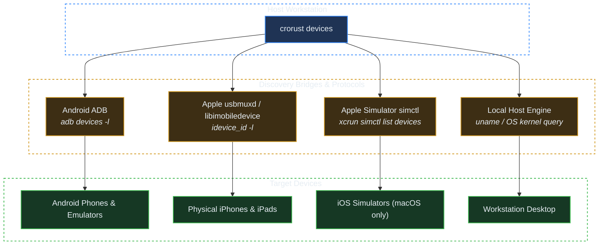
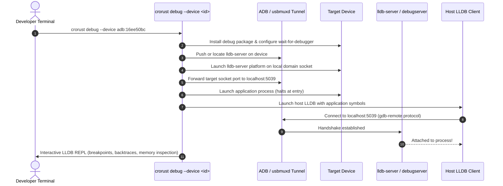

# Target Devices & Interactive Debugging

## 1. Device Discovery Architecture

`crorust` connects your development workstation directly to target hardware, simulators, and local execution environments. Running `crorust devices` enumerates all available destinations:

```sh
crorust devices
```

Example output:
```text
host                                              Linux               linux x64           Arch Linux 5.16.10-arch1-1
adb:16ee50bc                                      FP4                 android arm64       Android 11 (API 30)
imd:55abbd4b70af4353bdea2595bbddcac4a2b7891a      David’s iPhone      ios arm64           iPhone OS 15.3.1
sim:D9A01B2E-3184-4C2E-8A55-9B04D12FE3A1          iPhone 15 Pro       ios arm64           iOS 17.4 (Simulator)
```

### Discovery Protocols Under the Hood



1. **Android Physical Hardware & Emulators (`adb:<id>`)**:
   `AndroidDebugBridgeController` queries `adb devices -l`, parsing product identifiers, models, and CPU architectures (`ro.product.cpu.abi`).
2. **Apple Physical Hardware (`imd:<udid>`)**:
   Communicates over USB via `usbmuxd` (the multiplexed daemon running on port 27015). Works on Linux, macOS, and Windows.
3. **Apple iOS Simulator (`sim:<uuid>`)**:
   Queries `xcrun simctl` on macOS hosts to find booted or available iOS simulator runtimes.
4. **Local Host (`host`)**:
   Detects current host operating system and CPU architecture for instant desktop execution.

---

## 2. Deploy & Run Workflow (`crorust run`)

Passing `--device <id>` tells `crorust` to automatically infer the target platform and architecture:

```sh
# Deploy and stream logs from an Android phone
crorust run --device adb:16ee50bc

# Deploy to an iOS Simulator
crorust run --device sim:D9A01B2E-3184-4C2E-8A55-9B04D12FE3A1
```

### Execution Steps
1. **Target Architecture Inference**: Queries the device to determine whether it is 64-bit ARM (`arm64`) or x86_64 (`x64`).
2. **Build & Package**: Triggers Cargo compilation and format bundling (`.apk`, `.app`).
3. **Installation**: Transfers the package over the bridge protocol (`adb install -r` or `ideviceinstaller`).
4. **Activity Launch**: Triggers the entry point activity (`am start -n <package>/<activity>`).
5. **Log Streaming**: Attaches to `logcat` (filtering on the application's process ID) or stdout, streaming clean output to your terminal with automatic process cleanup on `Ctrl+C`.

---

## 3. Interactive Remote LLDB Debugging (`crorust debug`)

When diagnosing memory corruption, segfaults, or panic backtraces, printf-style debugging is inefficient. `crorust debug` provisions an interactive LLDB debugging session:



### Android Debugging Mechanics
1. `crorust` locates `lldb-server` inside the Android NDK staged in `.cache/crorust/`.
2. It pushes `lldb-server` to `/data/local/tmp/` on the device and gives it execute permissions (`chmod 755`).
3. It launches `lldb-server` listening on a UNIX domain socket.
4. It invokes `adb forward tcp:5039 localabstract:lldb-server` to tunnel packets over USB.
5. It drops the developer into the standard LLDB prompt with full source line mappings.

### iOS Debugging Mechanics
1. On physical iPhones, `crorust` mounts the Apple Developer Disk Image (`DDI`) over USB.
2. It starts `debugserver` located inside the developer image.
3. It tunnels the communication port back to the host via `usbmuxd`.
4. It connects host LLDB, giving developers on Linux and macOS full debugging capabilities.
