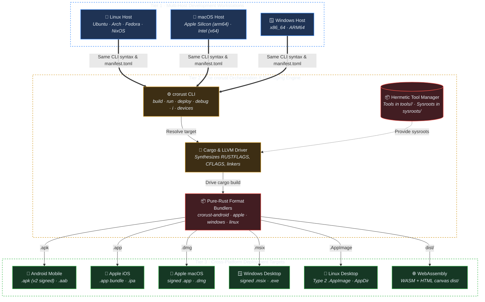
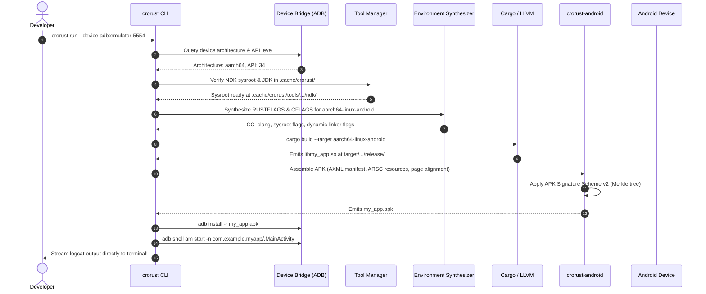

# croRust High-Level Architecture Overview

## 1. The Core Problem: The Cross-Compilation Wall

In modern software development, compiling software for multiple operating systems usually forces teams to adopt one of two painful compromises:

1. **The Siloed Workstation Trap**: iOS builds must be run on macOS with Xcode; Windows MSIX packaging requires Visual Studio on Windows; Android builds demand 15GB of Android Studio, Gradle, and Android Gradle Plugin (AGP) caches. Team members cannot reproduce each other's builds locally.
2. **The Cloud CI Bottleneck**: Developers write code locally, push blind commits, and wait 20 minutes for GitHub Actions runners to tell them that an iOS codesign identity or Windows manifest XML is malformed.

`crorust` breaks down this wall. Its primary design goal is:
> **Any engineer on Linux, macOS, or Windows can compile, package, and cryptographically sign production-ready native applications for all desktop, mobile, and web targets using the same command-line interface on the exact same codebase.**

---

## 2. The Three-Tier Architectural Model

To make cross-compilation manageable and predictable, `crorust` divides the entire system into three discrete tiers:



### Tier 1: Multi-Host Development Workstations
Workstations represent where developers write and review code. Whether running Arch Linux, macOS Sonoma, or Windows 11, the developer experience is uniform. Workstation differences (such as Windows backslashes, macOS dynamic loader paths, or Linux case-sensitive filesystems) are handled internally by the engine so the developer never writes platform-specific wrapper scripts.

### Tier 2: The Orchestration & Packaging Engine
The engine is composed of four cooperating systems:
1. **Target Resolver**: Parses CLI arguments and device IDs (`adb:xyz`, `sim:UUID`, `host`) to produce a concrete `SessionBuildTarget` (platform, architecture, libc variant).
2. **Tool Manager**: Automatically discovers or downloads minimal SDK headers and sysroots into the local `.cache/crorust/` directory.
3. **Environment Synthesizer**: Constructs exact compiler flags (`--sysroot`, `-isystem`, `-Clink-arg=-fuse-ld=lld`) and injects them into Cargo.
4. **Pure-Rust Bundlers**: Receives the raw compiled binary from Cargo and packages it into the platform's native container format without calling proprietary external tools.

### Tier 3: Cross-Platform Deployment Targets
The output deliverables. These are not intermediate files; they are final, production-ready, cryptographically signed binaries ready to be sideloaded onto a physical device or uploaded to the Google Play Store, Apple App Store, or Microsoft Store.

---

## 3. The Lifecycle of a Build

When a developer runs `crorust run --device adb:emulator-5554`, the following sequence executes:



---

## 4. Key Architectural Contracts

The codebase relies on four foundational traits defined in [`crates/crorust/src/core/contracts.rs`](../crates/crorust/src/core/contracts.rs):

### 1. `ToolchainProvider`
Defines how platform SDKs and sysroots are located:
- `resolve_android_ndk()`: Finds or downloads the Android NDK sysroot headers and cross-compilers.
- `resolve_apple_sdk(platform)`: Locates `MacOSX.sdk` or `iPhoneOS.sdk`.
- `resolve_windows_sdk()`: Provides CRT headers and UCRT import libraries.

### 2. `BuildEnvironmentSynthesizer`
Generates compiler environment variables:
- Injects `-Clink-arg=-fuse-ld=lld` or `-Clinker=rust-lld`.
- Injects sysroot header search paths so C dependencies (`cc-rs`, `cmake-rs`) find cross-headers.

### 3. `PackageAssembler`
Accepts compiled binaries and manifest configurations, generating the final container format.

---

## 5. Directory Structure & Workspace Layout

```
crorust/
├── Cargo.toml                          # Workspace root manifest
├── README.md                           # Main documentation entrypoint
├── docs/                               # In-depth architectural guides
│   ├── overview.md                     # This document
│   ├── toolchains-and-sysroots.md      # Toolchain download & caching mechanics
│   ├── packaging-internals.md          # Pure-Rust packaging internals
│   ├── devices-and-debugging.md        # ADB, usbmuxd, and LLDB debugging
│   ├── configuration-guide.md          # manifest.toml reference
│   ├── template-guide.md               # Reference app (crorust.ruxt) guide
│   ├── cache-and-ci.md                 # Caching and CI matrix manual
│   └── crates/                         # Crate-specific architectural manuals
├── crates/
│   ├── crorust/                        # Orchestrator CLI & LLVM driver
│   ├── crorust-android/                # AXML, ARSC, APK Sig v2, AAB
│   ├── crorust-apple/                  # macOS/iOS .app, codesign, Notarization
│   ├── crorust-windows/                # MSIX OPC, 64KB block map, PRI, Authenticode
│   ├── crorust-linux/                  # AppDir, SquashFS backhand, Type 2 AppImage
│   ├── crorust-mvn/                    # PubGrub Maven dependency resolution
│   ├── crorust-common/                 # Alignment sinks, ELF parser, Clang VFS
│   └── crorust-runtime-stub/           # Minimal ELF AppImage runtime launcher
└── templates/
    └── crorust.ruxt/                   # Embedded reference application
```
