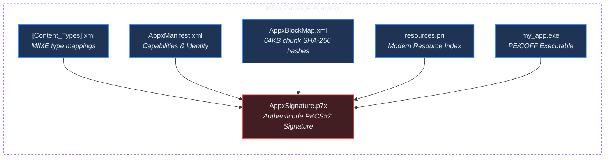

# Pure-Rust Packaging Internals & Format Specifications

## 1. The Packaging Bottleneck

When cross-compiling, producing a raw executable (`ELF`, `Mach-O`, or `PE/COFF`) is only half the battle. Operating systems do not install raw binaries; they demand structured application containers:

| Target Platform | Package Format | Native Vendor Toolchain | crorust In-Tree Crate |
| :--- | :--- | :--- | :--- |
| **Android** | `.apk` (v2 signed) | `aapt2`, `apksigner`, `zipalign` | `crorust-android` |
| **Apple macOS** | `.app` bundle / `.dmg` | `codesign`, `altool`, `hdiutil` | `crorust-apple` |
| **Apple iOS** | `.app` bundle / `.ipa` | Xcode, `codesign`, `security` | `crorust-apple` |
| **Windows** | `.msix` / `.exe` | `MakeAppx.exe`, `SignTool.exe` | `crorust-windows` |
| **Linux** | Type 2 `.AppImage` | `mksquashfs`, `appimagetool` | `crorust-linux` |

If an engine shells out to native vendor tools, building an iOS app requires macOS, building an MSIX requires Windows, and building an AppImage requires Linux with FUSE/root. `crorust` bypasses vendor tools by implementing format packaging in pure Rust.

---

## 2. Android: AXML, ARSC & Page Alignment

An Android APK is a ZIP container containing compiled resources, native libraries, and cryptographic signatures.

```mermaid
flowchart TB
    %% Styling Classes (Dark Mode & Dual-Theme High Contrast)
    classDef apkNode fill:#1f3354,stroke:#388bfd,stroke-width:1.5px,color:#e6edf3
    classDef sigNode fill:#421d22,stroke:#f85149,stroke-width:1.5px,color:#e6edf3
    classDef zipNode fill:#3d2e14,stroke:#d29922,stroke-width:1.5px,color:#e6edf3

    subgraph APK["Android APK Container Structure"]
        Manifest["AndroidManifest.xml<br/><i>Binary XML (AXML chunks)</i>"]
        Resources["resources.arsc<br/><i>Compiled string pools & types</i>"]
        ResDir["res/mipmap-.../<br/><i>Icons & graphical assets</i>"]
        Libs["lib/arm64-v8a/libapp.so<br/><i>Page-aligned uncompressed ELF (4KB/16KB)</i>"]
        Sig["APK Signing Block (ID 0x7109871a)<br/><i>Rayon parallel Merkle tree</i>"]
        CD["ZIP Central Directory"]
        EOCD["End of Central Directory"]

        Manifest --> Resources --> ResDir --> Libs --> Sig --> CD --> EOCD
    end

    %% Subgraph Styling
    style APK fill:none,stroke:#3fb950,stroke-width:1.5px,stroke-dasharray:4 4,color:#e6edf3

    %% Class Assignments
    class Manifest,Resources,ResDir,Libs apkNode
    class Sig sigNode
    class CD,EOCD zipNode
```



### 1. Binary XML (AXML)
Android rejects plaintext XML. `crorust-android` converts `AndroidManifest.xml` into binary chunks:
- `RES_XML_TYPE` (`0x0003`): Root XML chunk header.
- `RES_STRING_POOL_TYPE` (`0x0001`): UTF-8 string pool storing all tag names and string values.
- `RES_XML_RESOURCE_MAP_TYPE` (`0x0180`): Maps string pool indices to Android framework resource IDs (e.g. `0x01010003` for `android:name`).
- `RES_XML_START_ELEMENT_TYPE` (`0x0102`) & `END_ELEMENT_TYPE` (`0x0103`): Nested element tree.

### 2. Page Alignment (`mmap`)
To conserve RAM on mobile devices, Android's dynamic linker does not extract shared libraries (`.so`) to disk. Instead, it calls `mmap()` directly on the APK archive. Because the CPU Memory Management Unit (MMU) operates on physical pages, uncompressed shared libraries must start at a byte offset that is a multiple of the OS page size (4096 bytes on older kernels; 16384 bytes on Android 15+ kernels).

`AlignedArchiveSink` calculates the exact length of the ZIP local header:
$$\text{Header Length} = 30 + \text{Filename Length} + \text{Extra Field Length}$$
It injects dynamic padding into the extra field so the file data lands precisely on the page boundary.

### 3. APK Signature Scheme v2 (APK Sig Block 42)
Instead of hashing individual files like legacy JAR signatures, Scheme v2 treats the entire APK file as three contiguous byte regions:
1. Local File Headers and file payloads.
2. ZIP Central Directory.
3. ZIP End of Central Directory (EOCD).

`crorust-android` divides these regions into 1MB chunks, computes SHA-256 Merkle tree leaves using parallel Rayon workers, hashes the roots together, and signs the digest with an RSA private key. The signature block is injected directly between the file payloads and the Central Directory.

---

## 3. Apple: Darwin Bundles & Codesigning

Apple executables are wrapped in structured `.app` directory trees:

```
MyApp.app/
├── Contents/                             # macOS bundle layout
│   ├── MacOS/
│   │   └── my_app                       # Mach-O 64-bit executable (0o755)
│   ├── Resources/
│   │   └── AppIcon.icns                 # Pure-Rust converted multi-res icon
│   ├── Frameworks/
│   │   └── libhelper.dylib              # Embedded dynamic libraries
│   └── Info.plist                       # Property list metadata
```

### Pure-Rust Mach-O Codesigning
Apple's kernel validates Mach-O binaries using code signature blobs embedded in the executable's `LC_CODE_SIGNATURE` load command. `crorust-apple`:
1. Parses the Mach-O headers.
2. Computes SHA-256 hashes of every 4096-byte executable code page (`CodeDirectory`).
3. Embeds the application's XML entitlements.
4. Generates a Cryptographic Message Syntax (CMS) signature envelope using `apple-codesign`.

---

## 4. Windows: MSIX, 64KB Block Maps & Authenticode

Windows MSIX containers conform to ECMA-376 Open Packaging Conventions (OPC):



- **64KB Block Map (`AppxBlockMap.xml`)**: Windows downloads updates by fetching only altered 64KB chunks. `crorust-windows` computes SHA-256 hashes for every 64KB segment of every file.
- **Authenticode PKCS#7 (`AppxSignature.p7x`)**: The manifest, block map, and content types are signed with an X.509 certificate and stored uncompressed as `AppxSignature.p7x`.

---

## 5. Linux: Type 2 AppImage Composite Binary

A Type 2 AppImage is an ELF executable that contains its own compressed filesystem:

```
┌────────────────────────────────────────────────────────┐
│  128KB Precompiled ELF Runtime Stub                    │
│  (Contains AppImage Magic bytes at offset 8)           │
├────────────────────────────────────────────────────────┤
│  SquashFS v4 Compressed Filesystem ('hsqs')           │
│  ├── AppRun (Executable launcher script)               │
│  ├── TestApp.desktop (Freedesktop menu entry)          │
│  ├── .DirIcon (Application icon)                       │
│  ├── usr/bin/my_app (Compiled Rust binary)             │
│  └── usr/lib/ (Bundled dynamic libraries)              │
└────────────────────────────────────────────────────────┘
```

When run, the runtime stub mounts the SquashFS partition via FUSE to `/tmp/.mount_XXXXXX` and executes `AppRun`. `crorust-linux` builds this entire composite binary using the pure-Rust `backhand` library without requiring `mksquashfs` or root privileges.
