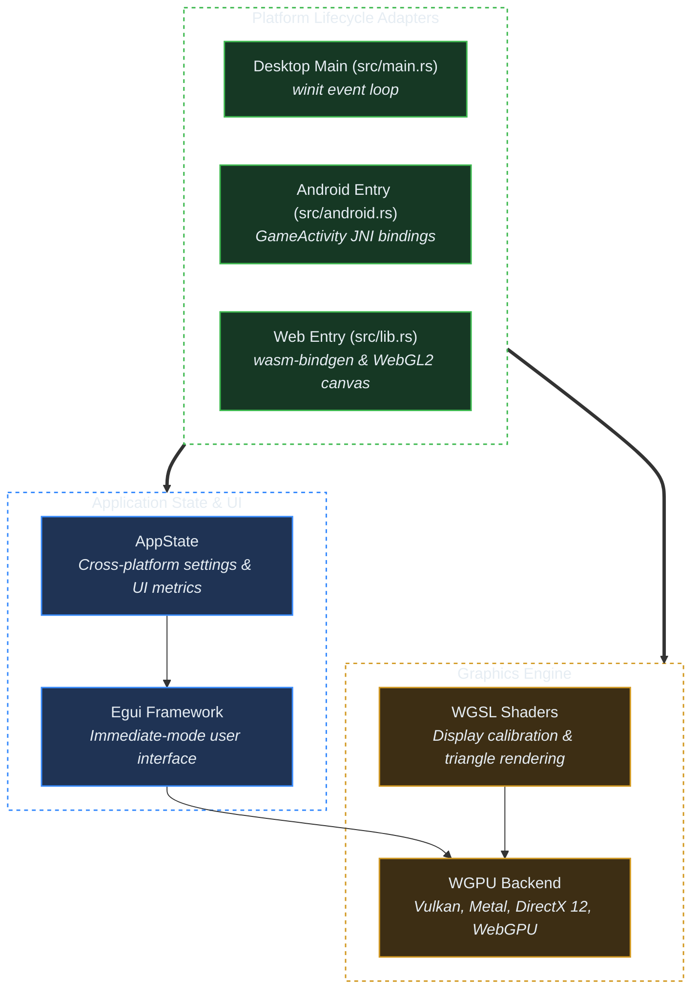

# Reference Application Template (`crorust.ruxt`)

## 1. Overview & Scaffolding

`crorust` includes an embedded reference application template located at [`templates/crorust.ruxt`](../templates/crorust.ruxt). It demonstrates production-ready cross-platform graphics, event handling, and windowing across Linux, macOS, Windows, Android, iOS, and WebAssembly.

Scaffolding a new application from the template requires a single command:

```sh
crorust template init my_app
cd my_app
crorust run
```

---

## 2. Technical Architecture



### The Rendering Pipeline (`egui` + `wgpu`)
The reference application uses immediate-mode GUI with `egui`, rendered through `wgpu`. This provides:
- **Zero Platform-Specific Rendering Code**: The exact same UI code draws widgets on macOS Metal, Windows DirectX 12, Android Vulkan, and Browser WebGPU.
- **Hardware Acceleration**: 60–120 FPS fluid rendering with low CPU overhead.
- **Display Calibration Tools**: Built-in visual tools demonstrating display gamut, DPI scaling, and touch input handling.

---

## 3. Platform Lifecycle Adapters

Different operating systems require fundamentally different process entry points:

### 1. Desktop Platforms (Linux, macOS, Windows)
`src/main.rs` initializes standard logging and launches the `winit` event loop on the main thread:
```rust
fn main() {
    let event_loop = EventLoop::new().expect("Failed to create event loop");
    let mut app = App::new();
    event_loop.run_app(&mut app).expect("Event loop terminated with error");
}
```

### 2. Android (`GameActivity` JNI)
Android processes are created by the zygote and driven by the Java/Kotlin runtime. Rather than using legacy `NativeActivity` (which suffers from keyboard and orientation bugs), `crorust` integrates Google's modern `GameActivity`:
- When Android creates the activity, `android_main` is invoked from a native worker thread.
- Native events (touch pointers, keypresses, window size adjustments) are polled via the Android `ALooper` and translated into `winit` window events.

### 3. WebAssembly (`wasm32-unknown-unknown`)
`src/lib.rs` exports an initialization function marked with `#[wasm_bindgen(start)]`:
- Attaches the `wgpu` rendering surface to an HTML `<canvas id="crorust-canvas">`.
- Binds JavaScript touch and mouse events into the Rust application loop via `web-sys`.

---

## 4. Customizing Your Application

After initializing the template, common customization points include:

1. **Changing Application Name & ID**:
   Edit `manifest.toml` to set your package name, version, and unique reverse-DNS identifier (`com.yourname.app`).
2. **Replacing Application Icons**:
   Place a high-resolution 512x512 PNG at `assets/icon.png`. `crorust` automatically generates all multi-resolution mipmaps and icons during packaging.
3. **Adding 3D Assets or Fonts**:
   Drop assets into the `assets/` folder. They are automatically packaged into the final APK, macOS bundle, or MSIX package.
