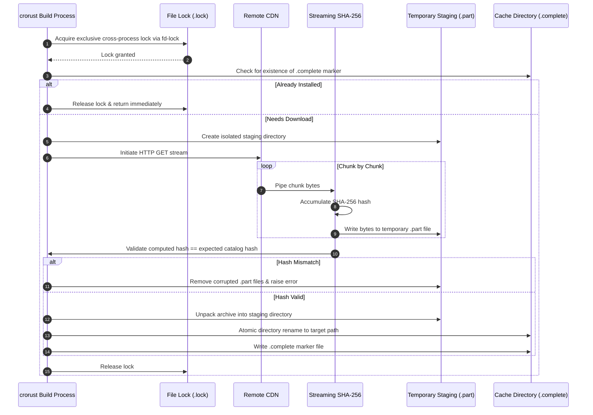

# Hermetic Toolchains & Managed Sysroots

## 1. The Sysroot Problem in Cross-Compilation

To compile C/C++ or Rust code targeting another operating system, the compiler requires two distinct assets:

1. **Host-Executable Tools**: Compilers, linkers, and code generators that run on *your current workstation* (e.g., LLVM `clang`, Android `kotlinc`, Adoptium JDK 17, `d8`).
2. **Target Platform Sysroots**: Header files (`.h`) and binary link libraries (`.so`, `.dylib`, `.lib`, `.a`) that define the Application Binary Interface (ABI) of the *target machine* (e.g., Android Bionic libc, Windows SDK UCRT headers, Apple Frameworks).

Traditional workflows require installing massive host suites (Xcode on macOS, Visual Studio on Windows, Android Studio on Linux) just to obtain these header files and libraries. `crorust` decouples these assets, downloading and staging minimal release archives directly into a project-local or global cache.

---

## 2. Multi-Host Cache Architecture

The cache directory is laid out with strict separation between host-specific binaries and host-independent target sysroots:

```
<cache_root>/
├── tools/                                # Host-specific executable utilities
│   ├── x86_64-unknown-linux-gnu/         # Linux x86_64 tools
│   │   ├── jdk/                          # Adoptium OpenJDK 17
│   │   ├── kotlinc/                      # Kotlin compiler
│   │   ├── platform-tools/               # Android adb
│   │   └── ndk/                          # NDK clang toolchains
│   ├── aarch64-apple-darwin/             # macOS Apple Silicon tools
│   └── x86_64-pc-windows-msvc/           # Windows x86_64 tools
└── sysroots/                             # Target SDK headers & import libraries
    ├── Windows.sdk/                      # Windows CRT headers & UCRT .lib files
    ├── MacOSX.sdk/                       # macOS framework headers & tbd stubs
    ├── iPhoneOS.sdk/                     # iOS hardware framework stubs
    └── iPhoneSimulator.sdk/              # iOS simulator framework stubs
```

### Why Host-Triple Namespacing Matters
Developers frequently share project folders across virtual machines, dual-boot partitions, or network shares (NFS, SMB). If host tools were saved in a flat `tools/` folder, a Linux VM would attempt to execute Windows `.exe` tools or macOS Mach-O binaries, causing cryptic `Exec format error` failures. 

By namespacing tools under `tools/<host-triple>/`:
- Workstations running different operating systems on the same shared filesystem never corrupt each other's binaries.
- Sysroots (which consist solely of C headers and target link libraries) are stored in `sysroots/` because they are identical regardless of which host OS executes the compiler.

---

## 3. Concurrency & Integrity Invariants

When downloading dozens of megabytes of SDK components over the internet, network failures or concurrent builds must never leave the cache in a corrupted state. `crorust` enforces three strict safety invariants:



### 1. Streaming SHA-256 Verification
Payload bytes are hashed as they arrive over the HTTP stream. The entire archive is validated before unpacking begins. If a connection drops, a corporate proxy modifies bytes, or a packet is corrupted, the `.part` file is deleted immediately.

### 2. Cross-Process Advisory Locking via `fd-lock`
If two developers run builds simultaneously, or if a build script launches multiple cargo jobs in parallel, both processes attempt to download the same tool. `fd-lock` uses OS-level file locking (`fcntl` on Unix, `LockFileEx` on Windows). The second process blocks cleanly until the first process finishes downloading and unpacking.

### 3. Atomic Staging & `.complete` Marker
Archives are unpacked into a temporary folder. Once extraction succeeds, the folder is atomically renamed, and an empty `.complete` file is written. Any interrupted extraction leaves no `.complete` file, signaling the next build to clean up and re-extract.

---

## 4. Enterprise Mirrors & Air-Gapped CI

In enterprise networks or secure air-gapped CI environments, build machines are prevented from accessing arbitrary public URLs. `crorust` provides two configuration controls in `manifest.toml`:

```toml
[toolchain]
# Rewrite all upstream tool URLs to point to your internal artifact mirror
mirror_url = "https://artifactory.internal.corp/crorust-mirrors"

# Strictly forbid network calls; fail fast if any tool is missing
offline = true
```

When `offline = true` is enabled, `crorust` will never initiate an HTTP request. If any required SDK is missing from `.cache/crorust/`, it halts with an explicit error detailing the missing files and explaining how to pre-stage them.

---

## 5. Nix & NixOS Dynamic Linker Accommodation

On standard Linux distributions (Ubuntu, Fedora, Arch), dynamic executables expect the ELF interpreter at `/lib64/ld-linux-x86-64.so.2`. On NixOS, no `/lib64` directory exists; all libraries and interpreters reside in hash-indexed paths under `/nix/store/`.

When `crorust` runs hermetic binaries (like Adoptium JDK 17 or Android NDK Clang) on NixOS, standard execution would immediately fail with `No such file or directory`. `crorust` automatically detects `/nix/store` environments and:
1. Locates the active Nix dynamic linker.
2. Uses `patchelf` or wraps execution with the system loader to ensure hermetic tools execute transparently without system containerization.
